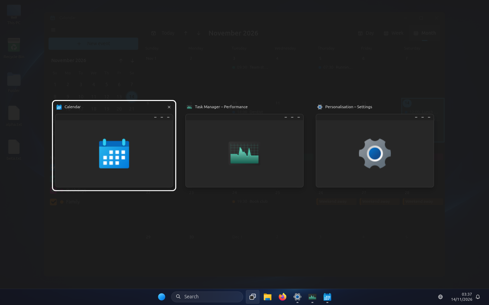
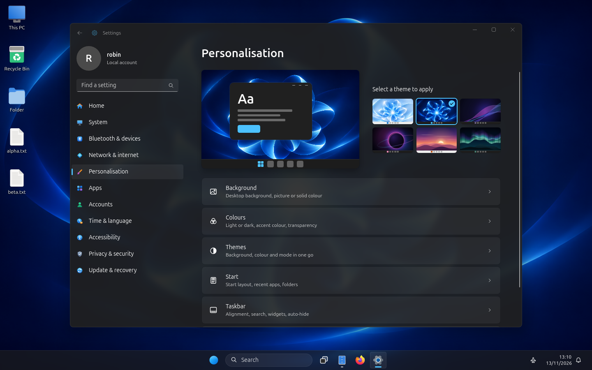
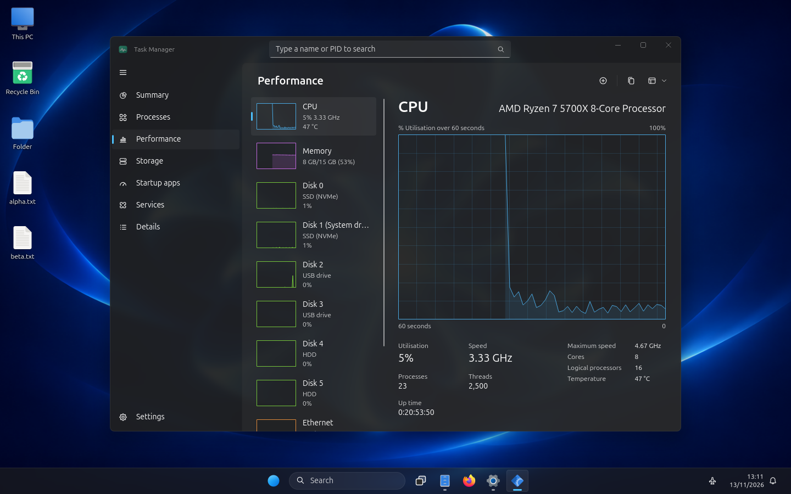
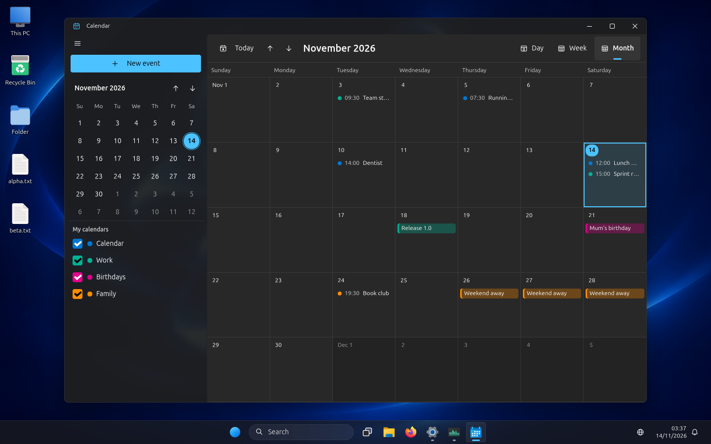

<p align="center">
  
</p>

<h1 align="center">WinPoint</h1>

<p align="center">
  <strong>A Windows 11 style desktop for GNOME, in Rust and GTK 4</strong>
</p>

<p align="center">
  <a href="https://github.com/roboburr/WinPoint/releases/latest"></a>
  <a href="LICENSE"></a>
  
  <br><br>
  <a href="#screenshots">Screenshots</a> · <a href="#features">Features</a> · <a href="#install">Install</a> · <a href="#build-from-source">Build</a> · <a href="README.nl.md">Nederlands</a>
</p>

WinPoint gives GNOME 50 a Windows 11 style taskbar, Start menu, quick settings, notification centre and desktop, plus its own File Explorer, Settings and Task Manager. A GNOME Shell extension fits it into GNOME; the rest is native GTK 4 and Rust.

<p align="center">
  
</p>

## Screenshots

<table>
  <tr>
    <td align="center" width="50%"><br><sub><b>Desktop</b> with icons and the taskbar</sub></td>
    <td align="center" width="50%"><br><sub><b>Win+X menu</b>: right-click Start</sub></td>
  </tr>
  <tr>
    <td align="center"><br><sub><b>Quick settings</b></sub></td>
    <td align="center"><br><sub><b>Notifications and calendar</b></sub></td>
  </tr>
  <tr>
    <td align="center"><br><sub><b>Task View</b>: Alt+Tab</sub></td>
    <td align="center"><br><sub><b>File Explorer</b> with tabs</sub></td>
  </tr>
  <tr>
    <td align="center"><br><sub><b>Settings</b>: Personalisation</sub></td>
    <td align="center"><br><sub><b>Task Manager</b>: Performance</sub></td>
  </tr>
  <tr>
    <td align="center"><br><sub><b>Calendar</b>: month view</sub></td>
    <td align="center"><br><sub><b>Light theme</b></sub></td>
  </tr>
</table>

## Features

- **Taskbar**: pinned and running apps with grouping and jump lists, tray icons, clock, centred or left aligned, optional auto-hide. With more than one display, each display gets its own taskbar with the apps open on it, as in Windows 11.
- **Start**: pinned apps, All apps, recommended files, and search over apps, settings, files and the web.
- **Quick settings**: Wi-Fi, Bluetooth, flight mode, night light, dark mode, do not disturb, brightness, volume and media controls.
- **Notification centre** with pop-up toasts and a month calendar.
- **Win+X menu** and **Task View**.
- **Desktop** with This PC, Recycle Bin, your files, context menus, rename and drag.
- **Frosted glass** from GNOME Shell's own blur, and Windows 11 caption buttons for your other GTK apps.
- **Apps**: File Explorer (also the Open and Save dialog for apps that use the desktop portal), Settings, Task Manager, Alles (instant file search, modelled on [Everything](https://www.voidtools.com/) by voidtools), Disks, Default apps, App Installer (AppImage, DEB, Flatpak, Snap) and Calendar.
- **Dutch and English**, switchable at any time, separate from GNOME's language.
- **Shortcuts**: the Windows key opens Start, Alt+Tab Task View and Ctrl+Alt+Delete Task Manager.

Settings includes GNOME-backed display, sound, mouse, touchpad, keyboard, accessibility, networking, accounts and privacy controls in Windows-style pages. Changes follow GNOME's managed-setting rules; optional controls appear only when their hardware or service is available.

## Requirements

- Ubuntu 26.04 with GNOME Shell 50 on Wayland, the only tested system. Releases are built for x86_64.
- **Not yet on Ubuntu 26.10** (GNOME 51): the installer stops with a message about the GNOME version. Support is on the way, see [#1](https://github.com/roboburr/WinPoint/issues/1).
- Python 3 for the installer, which checks everything else (PyGObject included) and names any missing Ubuntu package.
- Optional: FFmpeg for video thumbnails; PackageKit, Flatpak or snapd for App Installer.

## Install

Download `winpoint-<version>-linux-x86_64.tar.gz` from the [latest release](https://github.com/roboburr/WinPoint/releases/latest) into your Downloads folder, open a terminal and paste this line (the release notes have it for that release):

```bash
cd "$(xdg-user-dir DOWNLOAD)" && tar -xzf winpoint-0.9.7-linux-x86_64.tar.gz && ./winpoint-0.9.7/scripts/install.sh
```

The installer puts WinPoint in your home folder (`~/.local`) and adds **WinPoint** to the login screen, next to Ubuntu. It asks for your password once; an account that isn't an administrator needs an administrator's password. Then sign out: WinPoint starts at the next sign-in. Your Ubuntu session keeps its own look and dock; pick **Ubuntu** with the gear at the bottom right of the login screen to use it.

The installer picks Dutch or English from your system's language and region. Change it any time in **Settings › Time & language › Language & region**.

## Update

The latest release is **[WinPoint 0.9.7](https://github.com/roboburr/WinPoint/releases/tag/v0.9.7)**. Type directly in the taskbar and see results in Start. Opening and closing Start keeps the taskbar visible. Task Manager groups app helpers across separate launcher services, fresh installs select the bundled Windows icons, and the volume slider has been refined. See the [changelog](CHANGELOG.md#097) for the full list.

WinPoint checks GitHub once a day and tells you when a new release is out. Click **Download and install** in **Settings › Update & recovery**: WinPoint downloads it, checks it against GitHub's checksum and installs it, keeping your settings. Then restart WinPoint or sign out and back in, as the page says. Automatic checks can be turned off under **Advanced options**; installing a newer release by hand with the line above works too.

To check now, open **Settings › Update & recovery › Check for updates**. Version 0.9.7 is offered to earlier releases and the unpublished 0.9.1 development version. The download includes all 19 programs and the GNOME extension. Installing the update leaves running programs in place; the page tells you when to restart WinPoint or sign out to use the new components.

## Uninstall

Sign in to **Ubuntu** (not WinPoint), open a terminal and run:

```bash
~/.local/bin/winpoint-uninstall
```

It asks for your password once and removes WinPoint's files and its choice at the login screen. WinPoint 0.9.0 has no `winpoint-uninstall` yet: update it first, or run `./scripts/uninstall.sh` in the unpacked folder of a newer release. Your settings (`~/.config/win11-gnome`) and Calendar events (`~/.local/share/win11-gnome-calendar`) stay; for a clean removal, delete those and `~/.cache/win11-gnome` too.

## Build from source

The current source is on **`main`**. Releases use tags such as `v0.9.7`; temporary work branches are removed after integration.

You need Rust 1.92 or newer (Ubuntu's `cargo` package is new enough) and the GTK 4 development files:

```bash
sudo apt install git build-essential pkg-config cargo libglib2.0-dev libgdk-pixbuf-2.0-dev libgtk-4-dev libarchive13t64
git clone https://github.com/roboburr/WinPoint.git
cd WinPoint
cargo fetch --locked
cargo fetch --locked --manifest-path native/Cargo.toml
./scripts/build.sh --lang en
./scripts/install.sh
```

`build.sh` builds offline, so the two `cargo fetch` lines download the crates first. The programs land in `target/release`, where the installer finds them. If you set `CARGO_TARGET_DIR`, point the installer at it: `WIN11_BUILD_DIR="$CARGO_TARGET_DIR/release" ./scripts/install.sh`. `WIN11_BUILD_JOBS` sets the number of parallel build jobs (default 2).

## How it works

A GNOME Shell extension starts `win11-shell`, one GTK 4 process for the taskbar, Start, the flyouts and the desktop, and handles window placement, blur and shortcuts. A Rust backend gives it apps, settings, tray icons, notifications, sound, network, power and files over a local JSON API; every app is its own GTK 4 process. The extension runs only in the WinPoint session; your Ubuntu session doesn't load it.

Settings live in `~/.config/win11-gnome/settings.json` (defaults in [host/src/settings-defaults.json](host/src/settings-defaults.json)). Contributors: start with [native/ARCH.md](native/ARCH.md), [native/APPS.md](native/APPS.md) and [tests/gnome/README.md](tests/gnome/README.md), and before a pull request run `python3 -B tools/i18n/check.py` (every UI text is a Dutch/English pair) and `tests/rust-sandbox/run-tests.sh`.

## Known limitations

- Ubuntu 26.10 (GNOME 51) is not supported yet; support is on the way ([#1](https://github.com/roboburr/WinPoint/issues/1)). Use Ubuntu 26.04 LTS until then.
- Task View shows app icons, not live window thumbnails.
- The Win+X shortcut does not work yet; right-click Start for that menu.
- Hardware-specific Settings controls depend on the hardware and GNOME services available. See [Settings validation](VALIDATION_SETTINGS.md) for tested coverage and remaining limits.
- App Installer has not yet been tested with real system installs.
- Password dialogs, PackageKit and NetworkManager messages and GNOME's own parts follow the system language, not WinPoint's.

## Licence

WinPoint is under the [MIT licence](LICENSE); [THIRD_PARTY_NOTICES.md](THIRD_PARTY_NOTICES.md) has the details and [LICENSES/](LICENSES/) the full texts. Exceptions:

- the **Win11 icon theme** by [yeyushengfan258](https://github.com/yeyushengfan258/Win11-icon-theme) (`vendor/icons/`, `vendor/icon-source/` and `vendor/ui/assets/icons/settings.svg`), which is **GPL-3.0-only** (changes in [vendor/ICON_PROVENANCE.md](vendor/ICON_PROVENANCE.md));
- the **Lotus wallpapers**, AI-generated and released under [CC0-1.0](LICENSES/CC0-1.0.txt);
- the Rust crates, which keep their own licences ([LICENSES/RUST-CRATES.md](LICENSES/RUST-CRATES.md)), and two Rust files translated from CPython (PSF-2.0).

WinPoint is an independent project, not affiliated with or endorsed by Microsoft. Windows and Windows 11 are trademarks of Microsoft Corporation. No Microsoft code, assets or fonts are included. Alles follows the look and search syntax of Everything by voidtools; it contains no voidtools code and is not affiliated with voidtools.
