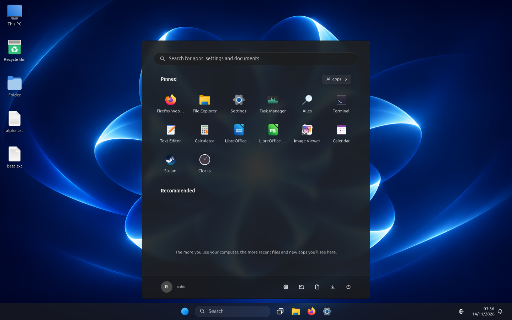
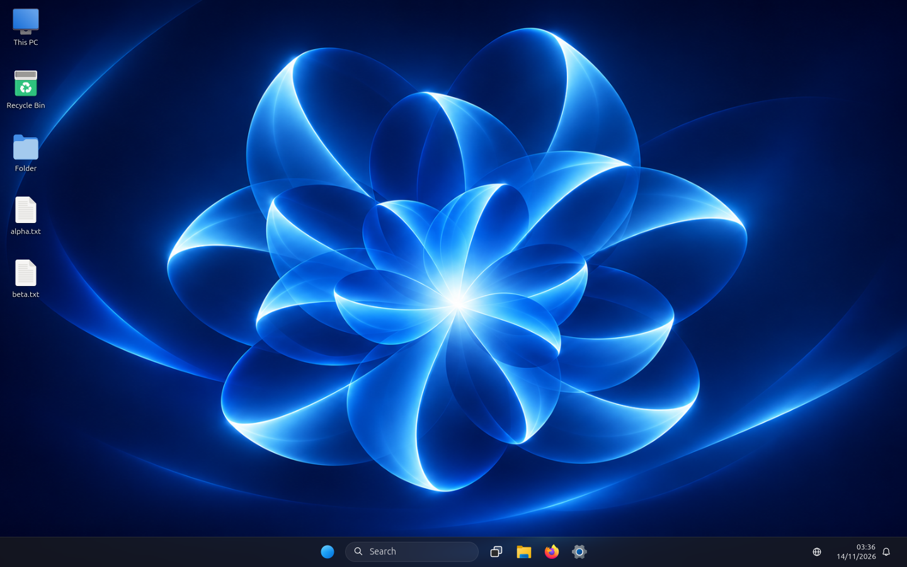
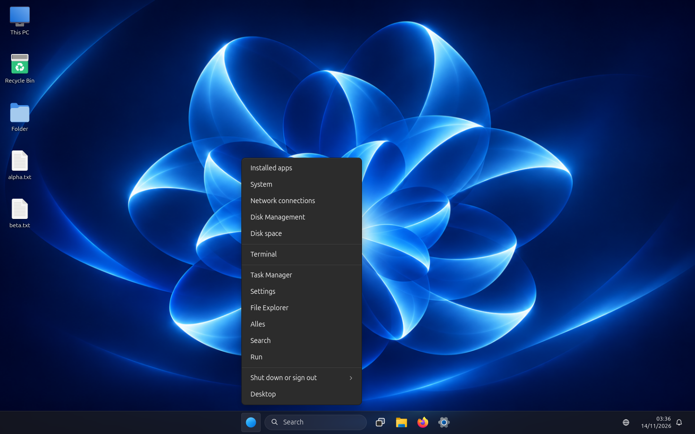
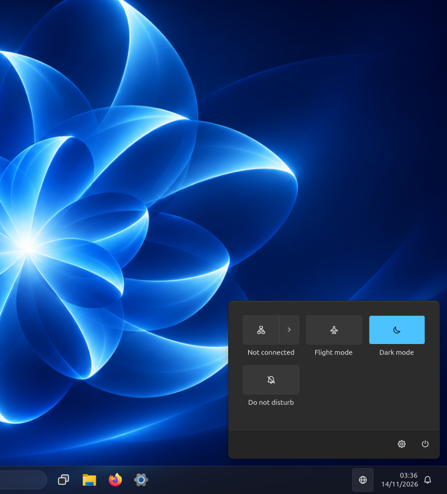
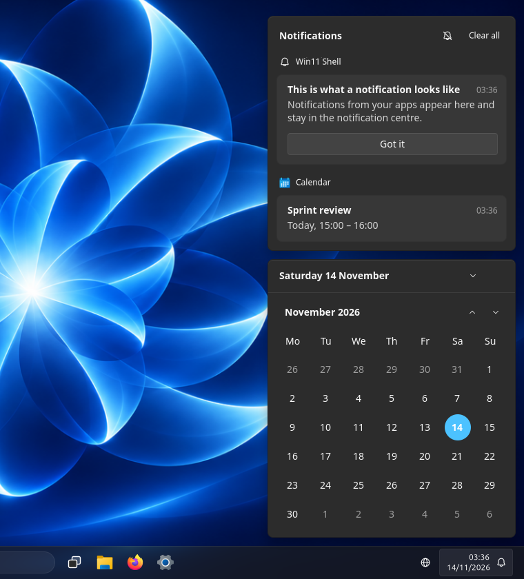
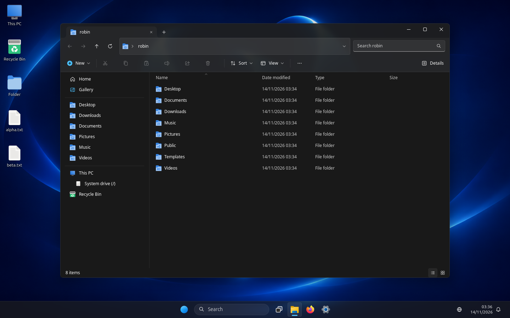
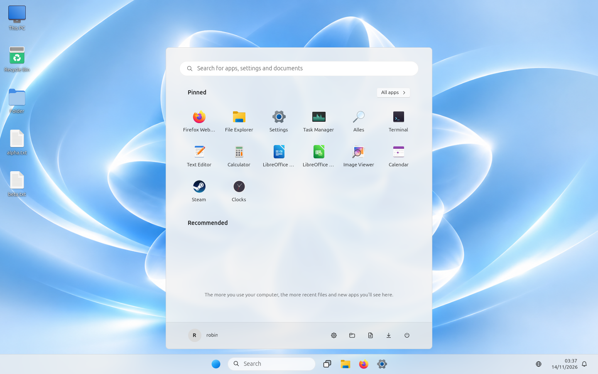
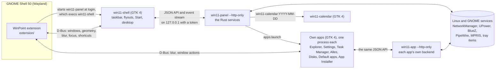

<p align="center">
  
</p>

<h1 align="center">WinPoint</h1>

<p align="center">
  <strong>A Windows 11 style shell for GNOME, in Rust and GTK 4</strong>
</p>

<p align="center">
  <a href="LICENSE"></a>
  
  
  
  
</p>

<p align="center">
  <a href="#screenshots">Screenshots</a> ·
  <a href="#features">Features</a> ·
  <a href="#how-it-works">How it works</a> ·
  <a href="#build">Build</a> ·
  <a href="#install">Install</a> ·
  <a href="#status-and-known-gaps">Status</a> ·
  <a href="README.nl.md">Nederlands</a>
</p>

<p align="center">
  
</p>

WinPoint turns GNOME 50 into a Windows 11 style desktop: a centred taskbar, Start, quick settings, a notification centre with a calendar, the Win+X menu, Task View and a desktop with icons. The shell is one native GTK 4 program in Rust (`win11-shell`). A GNOME Shell extension fits it into GNOME: it places the windows, adds GNOME's own frosted glass behind them and handles the shortcuts and window actions. It comes with its own apps (File Explorer, Settings, Task Manager and more) and a Calendar, all native GTK 4 programs as well; WinPoint has no web engine in it.

> [!NOTE]
> WinPoint is a development version (0.8.0) with no public release yet. It is built and tested on Ubuntu 26.04 with GNOME Shell 50 on Wayland. The project started as "Win11 for GNOME", so its programs, paths and extension keep their `win11` names.

## Screenshots

All screenshots come from a private, headless GNOME 50 session at 1440×900 in English; all but the last use the dark theme.

<table>
  <tr>
    <td align="center" width="50%"><br><sub><b>Desktop</b>: the Lotus wallpaper, desktop icons and the taskbar</sub></td>
    <td align="center" width="50%"><br><sub><b>Win+X menu</b>: right-click the Start button</sub></td>
  </tr>
  <tr>
    <td align="center"><br><sub><b>Quick settings</b>: here without network or audio, as in the test session</sub></td>
    <td align="center"><br><sub><b>Notifications and calendar</b>: click a day to open it in Calendar</sub></td>
  </tr>
  <tr>
    <td align="center"><br><sub><b>Task View</b>: Alt+Tab or the taskbar button</sub></td>
    <td align="center"><br><sub><b>File Explorer</b>: tabs, navigation pane and file actions</sub></td>
  </tr>
  <tr>
    <td align="center"><br><sub><b>Settings</b>: the Personalisation page</sub></td>
    <td align="center"><br><sub><b>Task Manager</b>: the Performance page</sub></td>
  </tr>
  <tr>
    <td align="center"><br><sub><b>Calendar</b>: the native GTK 4 Calendar app, month view</sub></td>
    <td align="center"><br><sub><b>Light theme</b>: Start with the light Lotus wallpaper</sub></td>
  </tr>
</table>

## Features

- **Taskbar**: pinned and running apps with grouping and jump lists, tray icons, clock and date, centred or left aligned, optional auto-hide.
- **Start**: pinned apps, All apps, recommended files, the user and power menus, and search over apps, settings, files and the web.
- **Quick settings**: Wi-Fi, Bluetooth, flight mode, dark mode, do not disturb, brightness and volume sliders, and media controls.
- **Notifications and calendar**: a notification centre with pop-up toasts, and a month calendar that opens the chosen day in the Calendar app.
- **Win+X menu**: the quick link menu, opened by right-clicking the Start button.
- **Task View**: every open window as a card, with Alt+Tab or the taskbar button.
- **Desktop**: wallpaper, This PC and Recycle Bin, your desktop files, context menus, rename, drag to move and undo.
- **Frosted glass**: GNOME Shell's own blur behind the taskbar, Start and the focused WinPoint app window, off with Transparency effects off or high contrast.
- **Windows caption buttons for GTK apps**: minimise, maximise and close in the Windows 11 style for other GTK 3 and GTK 4 apps (Snap and Flatpak apps keep their own).
- **Snap preview in the accent colour**: GNOME's window snap preview follows your accent colour instead of Ubuntu's orange.
- **Own apps**: File Explorer, Settings, Task Manager, Alles (instant file search), Disks, Default apps and App Installer, each a native GTK 4 program.
- **File picker**: in the WinPoint session, apps that use the desktop portal get File Explorer as their Open and Save dialog.
- **Native Calendar**: a GTK 4 Calendar with day, week and month views, local events and GNOME's calendars read-only.
- **Dutch and English**: its own language setting, separate from GNOME's; every open WinPoint window switches at once.

The Windows key opens Start, Alt+Tab opens Task View and Ctrl+Alt+Delete opens Task Manager. Disabling the extension gives these keys back to GNOME.

## How it works



When the extension is enabled it starts `win11-panel`, which replaces itself with `win11-shell`. The shell holds the taskbar, its flyouts, Start and the desktop as windows of one GTK 4 process, so opening Start starts no new process. The shell starts `win11-panel --http-only` as its backend: the host's Rust services for apps and pins, settings, tray icons, notifications, sound, network, power and files, with no window, reached over a local JSON API and event stream. The extension runs inside GNOME Shell and talks to the shell over D-Bus (`io.github.win11shell.GnomeBridge`): it puts the taskbar, Start and the desktop in place, hides GNOME's top bar and Ubuntu's desktop icons, adds the blur and focuses windows. If `win11-shell` is missing or stops, the extension brings back GNOME's top bar and a simple fallback bar (at login after 6 seconds, otherwise at once), and the Windows key or Alt+Tab starts the taskbar again. Disabling the extension restores the normal GNOME desktop.

The apps are separate processes that start on demand. An app's launcher (`win11-explorer`, `win11-app --app settings` and the others, which the app entries and the shell run) starts itself again in its own transient systemd user service (`app-win11-<kind>-….service` in `app.slice`, when the systemd user manager is available), where it replaces itself with the GTK 4 app (`win11-gtk-explorer`, `win11-gtk-settings` …). The app starts its own backend, `win11-app --app <kind> --http-only`, and talks to it the way the shell talks to its backend; window actions and the blur go straight to the extension over D-Bus. The file picker works the same way: `win11-file-portal`, the FileChooser backend of `xdg-desktop-portal`, shows File Explorer in picker mode for each request.

The code lives in two Cargo workspaces: the host in the top folder (the services, backends, launchers, workers and the file portal; it links GLib, GIO and GDK Pixbuf and no GTK) and `native/` (the GTK 4 programs: `win11-shell`, `win11-calendar` and the seven apps on their shared kit). gtk4-rs 0.11 needs a newer glib than the host, and Cargo allows one `glib-sys` per workspace. The earlier HTML versions in WebKitGTK are gone: the taskbar, Start and desktop since 13 November 2026, the apps since 14 November. The last commit with the HTML apps is tagged `last-webkit`.

**Memory.** In a private, headless GNOME session at 1440×900 with software rendering, `win11-shell`, its backend and GTK's SVG loader process together used **126 MiB PSS and 93 MiB anonymous memory plus swap** with the final build (14 November; a second run that day measured 144 and 110 MiB). On 12 November, in one session with both versions, the first native build used 119 and 76 MiB, against 443 and 269 MiB for the earlier WebKit taskbar, Start and desktop with all their WebKit processes (`tests/gnome/scenarios/native-shell.py`). The shell uses GTK's cairo renderer by default (`GSK_RENDERER=cairo`); with the GL renderer on llvmpipe that first build used 244 and 113 MiB. The apps, measured the same way, each with its own backend (`tests/gnome/scenarios/native-gtk-apps.py`):

| App | GTK 4 app, final build (14 Nov) | GTK 4 app, 13 Nov | WebKit app, 13 Nov |
|---|---|---|---|
| File Explorer | 42 MiB | 52 MiB | 220 MiB |
| Settings | 91 MiB | 102 MiB | 242 MiB |
| Task Manager | 49 MiB | 59 MiB | 220 MiB |
| Alles | 73–143 MiB | | |
| Disks | 30 MiB | | |
| Default apps | 41 MiB | | |
| App Installer | 29 MiB | | |

The figures are PSS, like the shell's. The first column is the final build without WebKit; Alles varies with how far its index has got. The other two columns come from one session on 13 November that ran both versions of the three apps, before the last fixes to the GTK 4 apps; a WebKit app also had its web process and network process. These figures leave out the compositor and GPU memory and come from test sessions, so treat them as an indication, not a guarantee. Details are in [notes/claude/gtk-native.md](notes/claude/gtk-native.md).

<details>
<summary><b>The programs</b></summary>

| Program | Started as | What it is |
|---|---|---|
| `win11-panel` | | Starts `win11-shell`; with `--http-only` it is the shell's backend |
| `win11-shell` | | The GTK 4 shell: taskbar, flyouts, Start and search, desktop |
| `win11-gtk-explorer` | `win11-explorer` | File Explorer, with tabs and tab transfer between windows; also the file picker |
| `win11-gtk-settings` | `win11-app --app settings` | Settings |
| `win11-gtk-taskmgr` | `win11-app --app taskmgr` | Task Manager |
| `win11-gtk-alles` | `win11-app --app alles` | Alles, with its own indexer while it is open |
| `win11-gtk-disks` | `win11-app --app disks` | Disks |
| `win11-gtk-defaultapps` | `win11-default-apps` | Default apps per file type or extension |
| `win11-gtk-installer` | `win11-installer` | App Installer: installs and removes AppImage, DEB, Flatpak and Snap packages, each after an explicit confirmation |
| `win11-calendar` | | Calendar (GTK 4), opened on a day from the taskbar calendar |
| `win11-file-portal` | | A FileChooser backend for `xdg-desktop-portal`, started on request |

The launchers in the middle column are what the app entries, the shell and the file type handlers run; each replaces itself with its app. When an app's binary is missing, the launcher names it, says to reinstall WinPoint and exits with code 127. `win11-app --app <kind> --http-only` is an app's backend. `win11-launch` (it also runs a short check after Ubuntu upgrades at every GNOME login), `win11-index-worker`, `win11-image-worker` and `win11-software-worker` are internal helpers. With the launchers that makes 19 programs.

App Installer copies an AppImage to `~/.local/opt/win11shell-appimages` with its own launcher and leaves the downloaded file where it is. Removing a Flatpak keeps its personal data, and removing a Snap does not purge it.

</details>

## Requirements

- Ubuntu 26.04 with GNOME Shell 50 on Wayland. That is the only tested system; another distribution with GNOME 50 and GTK 4.22 may work but has not been tried.
- To build: Rust 1.92 or newer (edition 2024), a C/C++ toolchain, `pkg-config`, and the development files of GLib 2.70 or newer, GDK Pixbuf and GTK 4.22 or newer.
- To run: GTK 4 (with Pango, graphene and cairo), GLib and GDK Pixbuf, `libarchive.so.13` (archives in File Explorer), and Python 3 with PyGObject (`python3-gi`) and `glib-compile-schemas` (`libglib2.0-bin`) for the installer and the uninstaller. The installer checks these and names the Ubuntu packages that are missing. WinPoint needs neither WebKitGTK nor GTK 3.
- Optional: FFmpeg and FFprobe for video thumbnails; PackageKit, Flatpak or snapd for App Installer, with `dpkg-deb` and `unsquashfs` (squashfs-tools) to read the details of DEB and Snap packages; bubblewrap to isolate the metadata and image decoders.

## Build

Get the source with git and build it. Every command after `cd WinPoint`, here and in the rest of this README, runs in the top folder of the checkout:

```bash
sudo apt install git build-essential pkg-config cargo libglib2.0-dev libgdk-pixbuf-2.0-dev libgtk-4-dev libarchive13t64
git clone https://github.com/roboburr/WinPoint.git
cd WinPoint
cargo fetch --locked
cargo fetch --locked --manifest-path native/Cargo.toml
./scripts/build.sh --lang en
```

Ubuntu 26.04's `cargo` package is Rust 1.93; a toolchain from rustup works too. `scripts/build.sh` builds both workspaces in release mode, offline and `--locked`, so `cargo fetch` downloads the crates once beforehand. All 19 binaries end up in `target/release` (or in `$CARGO_TARGET_DIR/release` when that is set). It runs two jobs by default; set `WIN11_BUILD_JOBS` for more. Without `--lang en` its messages are in Dutch.

Crates and build output can live anywhere, for example on another disk, through the usual Cargo variables. Set them before `cargo fetch` and pass the binary folder to the installer:

```bash
export CARGO_HOME=/path/to/cargo-home CARGO_TARGET_DIR=/path/to/target
cargo fetch --locked
cargo fetch --locked --manifest-path native/Cargo.toml
./scripts/build.sh --lang en
WIN11_BUILD_DIR="$CARGO_TARGET_DIR/release" ./scripts/install.sh --lang en
```

## Install

Build first (see [Build](#build)): the installer compiles nothing. It copies all 19 programs from one folder: from `$WIN11_BUILD_DIR` when that is set, otherwise from `target/release` (where `scripts/build.sh` puts them) or from `bin/` (the folder of a release archive made by `scripts/package.sh`), whichever holds all 19. If `CARGO_TARGET_DIR` points elsewhere, name the folder: `WIN11_BUILD_DIR="$CARGO_TARGET_DIR/release" ./scripts/install.sh --lang en`.

```bash
./scripts/build.sh --lang en
./scripts/install.sh --lang en
```

Without a complete build the installer stops before it changes anything and prints one line per missing program, for example `Missing: …/target/release/win11-explorer. Build it first with scripts/build.sh.` That folder lacks those programs: build with `./scripts/build.sh --lang en`, or point `WIN11_BUILD_DIR` at the folder your build went to. When the lines name `bin/`, the checkout has no `target/release` at all, only an old `bin/` folder, which the installer uses only when it holds all 19.

The installer checks the required programs and libraries first, then installs for your user: programs in `~/.local/bin`, the rest in `~/.local/share/win11-gnome`, and the app entries, icons and extension under `~/.local/share`. Under `~/.config` it adds an autostart entry for the post-upgrade check (with the login choice a second one, which puts GNOME's look back in the other sessions) and the file picker's portal settings and systemd user unit. It keeps existing settings. `--lang en` sets English on a first install; without it the installer guesses from your locale (Dutch for a Dutch locale, for the C locale and for an English locale with Dutch formats or a Dutch time zone, otherwise English), and a language already stored in `settings.json` always wins. It sets no default apps, except the handler for its own `win11-calendar:` links (one line in `~/.config/mimeapps.list`).

An install over an earlier version with the WebKit shell removes the old `win11-start` and `win11-desktop` with their app entries. An update from a version with the former WebKit apps also removes their data (storage and caches under `~/.local/share` and `~/.cache`, only folders that hold nothing but their files) and names each path it removes.

WinPoint becomes its own choice at the login screen, next to GNOME and Ubuntu. For that the installer runs `scripts/install-session.py`, which adds four small system files (a session entry for GDM, a gnome-session session, its systemd drop-in and a GNOME Shell session mode). `pkexec` asks for your password once. Then sign out, click your name, choose **WinPoint** with the gear at the bottom right, and sign in.

- **WinPoint** is GNOME with the WinPoint shell. Its session mode turns the extension on, without Ubuntu Dock, and WinPoint's file picker is the file chooser there.
- **GNOME** and **Ubuntu** stay as they were. At every login there, WinPoint puts back what it changed in GNOME (theme, icons, colour scheme, wallpaper, window buttons and the caption-button CSS) and turns its extension off.

`--no-session` skips this step, so no password is needed (the installer also skips it, without a message, when it does not run in a terminal or when gnome-session or pkexec is missing). It works only while the login choice is not installed; otherwise remove that first with `python3 scripts/install-session.py --remove`. WinPoint then runs inside your normal GNOME session: sign out and back in once, so GNOME Shell loads the new extension, and enable it:

```bash
gnome-extensions enable win11-gnome@win11shell.local
```

Ubuntu Dock stays on in that case (the installer turns off no dock extension) and can show next to the taskbar; `gnome-extensions disable ubuntu-dock@ubuntu.com` turns it off. WinPoint's file picker then also becomes the Open and Save dialog of apps that use the desktop portal in that session, even with the extension off; uninstalling undoes it.

You can add the login choice later, or remove it again (`--dry-run` shows what it would do):

```bash
python3 scripts/install-session.py
python3 scripts/install-session.py --remove
```

Then run `./scripts/install.sh` again (after a removal, with `--no-session`), so the installer sets up your own files to match: the autostart entry that puts GNOME's look back, and the file picker's portal choice.

<details>
<summary>Other install locations and optional system files</summary>

`WIN11_INSTALL_PREFIX` sets where `bin/` and `share/win11-gnome/` go, and `XDG_DATA_HOME` where the app entries, icons and extension go. Use absolute paths, and the same values when you uninstall. This is not a second install next to the default one: the app entries, the extension and the autostart entries are per user, so while another install exists the installer refuses with `Not overwritten: existing files without an installation marker:`. Uninstall that one first.

```bash
WIN11_INSTALL_PREFIX="$HOME/Apps/WinPoint test" ./scripts/install.sh
WIN11_INSTALL_PREFIX="$HOME/Apps/WinPoint test" ./scripts/uninstall.sh
```

The Update & recovery page in Settings works without system files. With them, Ubuntu's password dialog says what the release upgrade actions do. `scripts/install-system.py` installs or removes exactly those four files (two helpers in `/usr/libexec/win11-gnome` and two polkit policies); `pkexec` asks for the password, and `--dry-run` shows what it would do:

```bash
python3 scripts/install-system.py --dry-run
python3 scripts/install-system.py
python3 scripts/install-system.py --remove
```

</details>

## Uninstall

```bash
./scripts/uninstall.sh
```

This disables the extension, removes the files the installer marked as its own and undoes its file picker and `win11-calendar:` registrations. The WinPoint login choice stays until you remove it with `python3 scripts/install-session.py --remove`. Your settings in `~/.config/win11-gnome` stay. `--files-only` is for isolated test installs: it removes the files without touching the desktop session.

With the WinPoint login choice installed, uninstalling also puts GNOME's own look back (theme, icons, colour scheme, wallpaper, window buttons and the caption-button CSS). After a `--no-session` install it puts back only the icon theme. GNOME then keeps the GTK theme, colour scheme and window buttons that WinPoint set, the caption buttons for other GTK apps stay as an import line in `~/.config/gtk-3.0/gtk.css` and `~/.config/gtk-4.0/gtk.css`, and with a built-in WinPoint wallpaper GNOME's background points at a file that is gone. So before you uninstall such an install, turn off **Settings › Personalisation › Colours › Windows 11 caption buttons in apps**. Afterwards choose your style and wallpaper again under Appearance in GNOME's Settings; `gsettings reset org.gnome.desktop.wm.preferences button-layout` gives the window buttons back.

## Configuration

Everything is set in the Settings app. It stores the choices in `~/.config/win11-gnome/settings.json` (or `$XDG_CONFIG_HOME/win11-gnome/settings.json`); the backend notices changes to the file, also hand edits. The defaults are in [host/src/settings-defaults.json](host/src/settings-defaults.json). The keys that matter most:

| Key | Values | What it does |
|---|---|---|
| `language` | `"nl"`, `"en"` | The language of every WinPoint window (Settings › Time & language › Language & region) |
| `theme.mode` | `"dark"`, `"light"` | Dark or light theme |
| `theme.accent` | `"#0067c0"` | The accent colour |
| `theme.transparency` | `true`, `false` | Frosted glass (Transparency effects) |
| `theme.captionButtons` | `true`, `false` | Windows 11 caption buttons in other GTK apps |
| `taskbar.alignment` | `"center"`, `"left"` | Taskbar alignment |
| `taskbar.search` | `"box"`, `"iconLabel"`, `"icon"`, `"hidden"` | The search box on the taskbar |
| `taskbar.pinned` | desktop file ids | The apps pinned to the taskbar |
| `taskbar.autoHide` | `true`, `false` | Hide the taskbar automatically |
| `start.pinned`, `start.showRecommended` | list, `true`/`false` | Start's pinned apps and the Recommended section |
| `wallpaper.path` | `"builtin:lotus-dark"` or a file | The wallpaper; with `wallpaper.followTheme` a built-in one follows the light or dark theme |
| `desktop.showIcons` | `true`, `false` | Desktop icons |
| `time.h24`, `time.firstDayOfWeek` | `true`/`false`, `1` = Monday | Clock format and the taskbar calendar's first weekday |
| `notifications.dnd` | `true`, `false` | Do not disturb |

The GTK 4 programs use GTK's cairo renderer, which needs the least memory, unless `GSK_RENDERER` is set or `WIN11_SHELL_GL=1`, `WIN11_CALENDAR_GL=1` or `WIN11_APP_GL=1` asks for GTK's default; programs started from WinPoint get your own `GSK_RENDERER` back. The switches of the former WebKit apps (`~/.config/win11-gnome/no-gpu`, `WIN11SHELL_GPU`, `WIN11_WEBKIT_BROWSER_CACHE`) no longer do anything.

A few texts are not WinPoint's and stay in the language of GNOME or the system: polkit's password dialogs, PackageKit's messages and package descriptions, NetworkManager's texts, GTK's own texts (such as a text field's context menu) and GNOME's own parts, such as its quick settings and its notification that a window is ready. Alles is called Alles in both languages, and folders on disk, such as Desktop and Documents, are never renamed.

## Development

```text
native/shell/     win11-shell: src/panel/ (taskbar), src/flyouts/, src/start/, src/desktop/, css/
native/calendar/  win11-calendar
native/apps/      the seven apps, one crate each (win11-gtk-<kind>)
native/kit/       what the apps share: backend client, settings, theme, window frame, controls
host/             the Rust host: services and JSON API, launchers, file portal, workers, i18n tables
extension/        the GNOME Shell extension (panel, frosted glass, shortcuts, notifications, desktop)
vendor/ui/        the wallpapers and the Settings icon (the HTML apps are gone: git tag last-webkit)
vendor/host/      the original Python services, kept as a reference for comparison tests (not installed)
vendor/config/    the GTK caption button styles
vendor/icons/     the Win11 icon theme (GPL-3.0-only)
scripts/          build, install, uninstall, package and UI manifest checks
tests/            the GNOME session harness, Rust sandbox, installer and i18n tests
notes/claude/     design notes and the decision log (plan.md)
```

[native/ARCH.md](native/ARCH.md) describes how the shell's modules fit together, [native/APPS.md](native/APPS.md) the apps and their kit.

**A private GNOME session for tests.** `tests/gnome/harness.py` starts its own headless GNOME Shell 50 with a 1440×900 virtual monitor inside a bubblewrap sandbox, installs a build there and runs scenario files against it. It cannot reach your own session: it has its own home, its own D-Bus and no network. It needs `bwrap`, `dbus-run-session`, `strace`, `gnome-shell`, PyGObject and about 2.5 GB of free memory. It reads the 19 programs from `tests/build/native-release` in the checkout, and `guard-selftest` always does; `--build-dir` must also be a folder inside the checkout with all 19 (a link to a folder elsewhere does not count). The Rust tests read the same folder by default. Copy your build there once (from `"$CARGO_TARGET_DIR/release"` when the build went elsewhere):

```bash
mkdir -p tests/build/native-release
find target/release -maxdepth 1 -type f -executable -name 'win11-*' -exec cp -t tests/build/native-release {} +
python3 -B tests/gnome/harness.py guard-selftest
python3 -B tests/gnome/harness.py launch --own-lock run --lang en \
    --scenario tests/gnome/scenarios/native-shell.py
```

Results and screenshots land in `tests/gnome/scenarios/native-shell.out/`. The other scenarios are in `tests/gnome/scenarios/`; the screenshots in this README come from `readme-shots.py`. See [tests/gnome/README.md](tests/gnome/README.md) for all options and what the sandbox guards.

Other checks:

```bash
python3 -B tools/i18n/check.py
WIN11_LANG=en python3 scripts/verify-ui.py
tests/rust-sandbox/run-tests.sh
```

`tools/i18n/check.py` checks the Dutch and English texts, `scripts/verify-ui.py` the manifests of the wallpapers and icons in `vendor/ui`, and `tests/rust-sandbox/run-tests.sh` runs the host's Rust tests in a private sandbox. That script runs cargo with a clean environment: when your crates or build output live elsewhere, set `WIN11_CARGO_HOME` and `WIN11_CARGO_TARGET_DIR` (not `CARGO_HOME` and `CARGO_TARGET_DIR`); its result is in `tests/rust-sandbox/logs/test.log`. `tests/installer/run.sh` compares the installer byte for byte with an earlier commit (3b898e6) and needs the project's full git history, which this repository does not carry; it runs only in the author's checkout. `tools/heavy.sh` still has a lock path on the author's machine as its default; `WIN11_HEAVY_LOCK` overrides it, and the harness reads it too. Set it to the checkout's own lock, `WIN11_HEAVY_LOCK="$(pwd -P)/.heavy.lock"` (run from the checkout), the only one the harness's `--own-lock` accepts. `WIN11_GNOME_CONFIG_DIR` points the Rust programs at another settings folder; it is for tests only, because the extension and the installer keep reading `$XDG_CONFIG_HOME/win11-gnome`.

## Status and known gaps

WinPoint is work in progress. The current checks, with their environment and limits, are at the top of [VALIDATION.md](VALIDATION.md) (in Dutch); they prove the scenarios they name, not full parity with Windows 11 on every machine. The conditions for a first release are in [RELEASE_PLAN.md](RELEASE_PLAN.md) (in Dutch).

Known gaps:

- **Two commands without a receiver**: the `shell.command` events for Task Manager's "Run new task" (which opens the shell's search) and for the Open button on Settings' Clipboard page have no consumer in the new shell, so both do nothing.
- **When the shell fails**: if `win11-shell` is missing or fails, `win11-panel` exits; GNOME's top bar and the extension's basic fallback bar come back (at login after 6 seconds, otherwise at once), and the Windows key or Alt+Tab starts the taskbar again. A missing app binary is an error too: the launcher names it and exits with code 127; reinstall WinPoint.
- **Memory limits**: when the systemd user manager is available, the shell's backend runs in its own limited systemd group (`app-win11shell.slice`), but `win11-shell` itself still runs outside it.
- **Apps**: the GTK 4 apps follow the HTML apps they replaced screen by screen, but not every detail: dialogs, menus and toasts have no entrance animations, and some layouts for narrow windows are missing. [native/APPS.md](native/APPS.md) lists the differences per app.
- **App Installer**: the software engine is tested with generated packages and imitated package services, and the App Installer app with dry runs only, not yet with real system installs.
- **Task View** shows each window's app icon, not a live thumbnail.
- **Win+X** opens by right-clicking Start; the Win+X key itself is not bound yet.
- **Calendar**: in English the Calendar app starts the week on Sunday while the taskbar calendar uses `time.firstDayOfWeek` (Monday by default). GNOME's calendars and opening a day from the taskbar have not been tested in the private session.
- **Two calendars in All apps**: on a system with GNOME Calendar, Start's All apps (and GNOME's app grid) list both it and WinPoint's Calendar under the same name ("Calendar", in Dutch "Agenda").
- **Night light and displays**: night light is not in quick settings, and Settings shows the displays greyed out; both are set in GNOME's own Settings.
- **Release archive**: the archive that `scripts/package.sh` makes still contains `vendor/host`, the Python reference, which the installer does not install.
- **Log noise**: the apps set `GDK_DEBUG=portals`, so in a session without `xdg-desktop-portal` (such as the test sandbox) they log a harmless Gdk warning "Failed to read portal settings".
- **Automated coverage**: jump lists, the tray overflow, desktop context menus, rename and drag have no scenario yet.

## Licences

- WinPoint's own code and assets are under the [MIT licence](LICENSE). That includes `vendor/ui`, `vendor/host` and `vendor/config`, the author's own earlier work from the Win11 Shell project, except the third-party parts listed in [THIRD_PARTY_NOTICES.md](THIRD_PARTY_NOTICES.md).
- The bundled **Win11 icon theme** by [yeyushengfan258](https://github.com/yeyushengfan258/Win11-icon-theme) (`vendor/icons/`, `vendor/icon-source/` and `vendor/ui/assets/icons/settings.svg`) is under **GPL-3.0-only**, not MIT. It is based on Ubuntu's Yaru icons. The changes made to it are in [vendor/ICON_PROVENANCE.md](vendor/ICON_PROVENANCE.md).
- The default **Lotus wallpapers** (`vendor/ui/assets/wallpapers/lotus-dark.svg` and `lotus-light.svg`) are AI-generated (OpenAI ChatGPT image generation) and dedicated to the public domain under [CC0-1.0](LICENSES/CC0-1.0.txt).
- Two Rust files contain code translated from CPython (PSF-2.0), and the Rust crates linked into the programs keep their own licences ([LICENSES/RUST-CRATES.md](LICENSES/RUST-CRATES.md)).

What each part is, where it comes from and what its licence asks for is in [THIRD_PARTY_NOTICES.md](THIRD_PARTY_NOTICES.md); the full licence texts are in [LICENSES/](LICENSES/).

## Disclaimer

WinPoint is an independent project. It is not affiliated with, sponsored by or endorsed by Microsoft. Windows and Windows 11 are trademarks of Microsoft Corporation. No Microsoft code or assets are included: the look follows public WinUI 3 design values (colours, radii, type sizes), the icons are the GPL Win11 icon theme and the project's own drawings, the Start button is its own design (a blue disc), and no Microsoft fonts are bundled. Other product names and logos in the screenshots belong to their owners.
