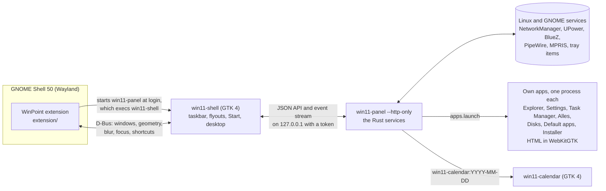

<p align="center">
  
</p>

<h1 align="center">WinPoint</h1>

<p align="center">
  <strong>A Windows 11 style shell for GNOME, in Rust and GTK 4</strong>
</p>

<p align="center">
  <a href="LICENSE"></a>
  
  
  
  
</p>

<p align="center">
  <a href="#screenshots">Screenshots</a> ·
  <a href="#features">Features</a> ·
  <a href="#how-it-works">How it works</a> ·
  <a href="#build">Build</a> ·
  <a href="#install">Install</a> ·
  <a href="#status-and-known-gaps">Status</a> ·
  <a href="README.nl.md">Nederlands</a>
</p>

<p align="center">
  
</p>

WinPoint turns GNOME 50 into a Windows 11 style desktop: a centred taskbar, Start, quick settings, a notification centre with a calendar, the Win+X menu, Task View and a desktop with icons. The shell is one native GTK 4 program in Rust (`win11-shell`), with no web engine in it. A GNOME Shell extension fits it into GNOME: it places the windows, adds GNOME's own frosted glass behind them and handles the shortcuts and window actions. It comes with its own apps (File Explorer, Settings, Task Manager and more) and a native Calendar.

> [!NOTE]
> WinPoint is a development version (0.8.0) with no public release yet. It is built and tested on Ubuntu 26.04 with GNOME Shell 50 on Wayland. The project started as "Win11 for GNOME", so its programs, paths and extension keep their `win11` names.

## Screenshots

All screenshots come from a private, headless GNOME 50 session at 1440×900 in English; all but the last use the dark theme.

<table>
  <tr>
    <td align="center" width="50%"><br><sub><b>Desktop</b>: the Lotus wallpaper, desktop icons and the taskbar</sub></td>
    <td align="center" width="50%"><br><sub><b>Win+X menu</b>: right-click the Start button</sub></td>
  </tr>
  <tr>
    <td align="center"><br><sub><b>Quick settings</b>: here without network or audio, as in the test session</sub></td>
    <td align="center"><br><sub><b>Notifications and calendar</b>: click a day to open it in Calendar</sub></td>
  </tr>
  <tr>
    <td align="center"><br><sub><b>Task View</b>: Alt+Tab or the taskbar button</sub></td>
    <td align="center"><br><sub><b>File Explorer</b>: tabs, navigation pane and file actions</sub></td>
  </tr>
  <tr>
    <td align="center"><br><sub><b>Settings</b>: the Personalisation page</sub></td>
    <td align="center"><br><sub><b>Task Manager</b>: the Performance page</sub></td>
  </tr>
  <tr>
    <td align="center"><br><sub><b>Calendar</b>: the native GTK 4 Calendar app, month view</sub></td>
    <td align="center"><br><sub><b>Light theme</b>: Start with the light Lotus wallpaper</sub></td>
  </tr>
</table>

## Features

- **Taskbar**: pinned and running apps with grouping and jump lists, tray icons, clock and date, centred or left aligned, optional auto-hide.
- **Start**: pinned apps, All apps, recommended files, the user and power menus, and search over apps, settings, files and the web.
- **Quick settings**: Wi-Fi, Bluetooth, flight mode, night light, dark mode, do not disturb, brightness and volume sliders, and media controls.
- **Notifications and calendar**: a notification centre with pop-up toasts, and a month calendar that opens the chosen day in the Calendar app.
- **Win+X menu**: the quick link menu, opened by right-clicking the Start button.
- **Task View**: every open window as a card, with Alt+Tab or the taskbar button.
- **Desktop**: wallpaper, This PC and Recycle Bin, your desktop files, context menus, rename, drag to move and undo.
- **Frosted glass**: GNOME Shell's own blur behind the taskbar, Start and the focused WinPoint app window, off with Transparency effects off or high contrast.
- **Windows caption buttons for GTK apps**: minimise, maximise and close in the Windows 11 style for other GTK 3 and GTK 4 apps (Snap and Flatpak apps keep their own).
- **Snap preview in the accent colour**: GNOME's window snap preview follows your accent colour instead of Ubuntu's orange.
- **Own apps**: File Explorer, Settings, Task Manager, Alles (instant file search), Disks, Default apps and an Installer.
- **Native Calendar**: a GTK 4 Calendar with day, week and month views, local events and GNOME's calendars read-only.
- **Dutch and English**: its own language setting, separate from GNOME's; every open WinPoint window switches at once.

The Windows key opens Start, Alt+Tab opens Task View and Ctrl+Alt+Delete opens Task Manager. Disabling the extension gives these keys back to GNOME.

## How it works



When the extension is enabled it starts `win11-panel`, which replaces itself with `win11-shell`. The shell holds the taskbar, its flyouts, Start and the desktop as windows of one GTK 4 process, so opening Start starts no new process. The shell starts `win11-panel --http-only` as its backend: the host's Rust services for apps and pins, settings, tray icons, notifications, sound, network, power and files, with no window and no WebKit, reached over a local JSON API and event stream. The extension runs inside GNOME Shell and talks to the shell over D-Bus (`io.github.win11shell.GnomeBridge`): it puts the taskbar, Start and the desktop in place, hides GNOME's top bar and Ubuntu's desktop icons, adds the blur and focuses windows. The apps are separate processes that start on demand. If `win11-shell` is missing or does not start, the extension shows a simple fallback bar after 6 seconds; disabling the extension restores the normal GNOME desktop.

The code lives in two Cargo workspaces: the host in the top folder (GTK 3 and WebKitGTK 4.1 for the apps) and `native/` (`win11-shell` and `win11-calendar`). gtk4-rs 0.11 needs a newer glib than the host, and Cargo allows one `glib-sys` per workspace.

**Memory.** In a private, headless GNOME session at 1440×900 with software rendering, `win11-shell`, its backend and GTK's SVG loader process together used **119 MiB PSS and 76 MiB anonymous memory plus swap**. The earlier WebKit taskbar, Start and desktop that it replaces used 443 MiB and 269 MiB, measured the same way with all their WebKit processes (`tests/gnome/scenarios/native-shell.py`). The shell uses GTK's cairo renderer by default (`GSK_RENDERER=cairo`); with the GL renderer on llvmpipe it was 244 and 113 MiB. These figures leave out the compositor and GPU memory and come from one test session, so treat them as an indication, not a guarantee. Details are in [notes/claude/gtk-native.md](notes/claude/gtk-native.md).

<details>
<summary><b>The programs</b></summary>

| Program | What it is |
|---|---|
| `win11-panel` | Starts `win11-shell`; with `--http-only` it is the shell's backend |
| `win11-shell` | The GTK 4 shell: taskbar, flyouts, Start and search, desktop |
| `win11-explorer` | File Explorer, with tabs and tab transfer between windows |
| `win11-app --app settings` | Settings |
| `win11-app --app taskmgr` | Task Manager |
| `win11-app --app alles` | Alles, with its own indexer while it is open |
| `win11-app --app disks` | Disks |
| `win11-default-apps` | Default apps per file type or extension |
| `win11-calendar` | Calendar (GTK 4), opened on a day from the taskbar calendar |
| `win11-installer` | Install and remove AppImage, DEB, Flatpak and Snap packages, each after an explicit confirmation |
| `win11-file-portal` | A FileChooser backend for `xdg-desktop-portal`, started on request |

`win11-launch`, `win11-index-worker`, `win11-image-worker` and `win11-software-worker` are internal helpers that start only when needed.

</details>

## Requirements

- Ubuntu 26.04 with GNOME Shell 50 on Wayland. That is the only tested system; another distribution with GNOME 50 and GTK 4.22 may work but has not been tried.
- To build: Rust 1.92 or newer (edition 2024), a C/C++ toolchain, `pkg-config`, the GTK 3 and WebKitGTK 4.1 development files for the apps and GTK 4.22 or newer for the shell and the Calendar.
- To run: the GTK 3, WebKitGTK 4.1 and GTK 4 libraries, `libarchive.so.13` (archives in File Explorer), and Python 3 with PyGObject (`python3-gi`) and `glib-compile-schemas` for the installer. The installer checks these and names the Ubuntu packages that are missing.
- Optional: FFmpeg and FFprobe for video thumbnails; PackageKit, Flatpak or snapd for the Installer; bubblewrap to isolate the metadata and image decoders.

## Build

```bash
sudo apt install build-essential pkg-config libgtk-3-dev libwebkit2gtk-4.1-dev libgtk-4-dev libarchive13t64
cargo fetch --locked
cargo fetch --locked --manifest-path native/Cargo.toml
./scripts/build.sh
```

`scripts/build.sh` builds both workspaces in release mode, offline and `--locked`, so `cargo fetch` downloads the crates once beforehand. All 12 binaries end up in `target/release`. It runs two jobs by default; set `WIN11_BUILD_JOBS` for more.

Crates and build output can live anywhere, for example on another disk, through the usual Cargo variables. Set them before `cargo fetch` and pass the binary folder to the installer:

```bash
export CARGO_HOME=/path/to/cargo-home CARGO_TARGET_DIR=/path/to/target
cargo fetch --locked
cargo fetch --locked --manifest-path native/Cargo.toml
./scripts/build.sh
WIN11_BUILD_DIR="$CARGO_TARGET_DIR/release" ./scripts/install.sh --lang en
```

## Install

```bash
./scripts/install.sh --lang en
```

The installer checks the required programs and libraries first, then installs for your user only: programs in `~/.local/bin`, the rest in `~/.local/share/win11-gnome`, and the app entries, icons and extension under `~/.local/share`. It never runs `sudo` and keeps existing settings. `--lang en` sets English on a first install; without it the installer guesses from your locale, and a language already stored in `settings.json` always wins. It sets no default apps, except the handler for its own `win11-calendar:` links, and it makes its file picker your FileChooser portal backend.

Sign out and back in once, so GNOME Shell loads the new extension, then enable it:

```bash
gnome-extensions enable win11-gnome@win11shell.local
```

Ubuntu Dock or another dock extension stays on and can show next to the taskbar. To turn Ubuntu Dock off:

```bash
gnome-extensions disable ubuntu-dock@ubuntu.com
```

<details>
<summary>Other install locations and optional system files</summary>

`WIN11_INSTALL_PREFIX` sets where `bin/` and `share/win11-gnome/` go, and `XDG_DATA_HOME` where the app entries, icons and extension go. Use absolute paths, and the same values when you uninstall:

```bash
WIN11_INSTALL_PREFIX="$HOME/Apps/WinPoint test" ./scripts/install.sh
WIN11_INSTALL_PREFIX="$HOME/Apps/WinPoint test" ./scripts/uninstall.sh
```

The Windows Update page in Settings works without system files. With them, Ubuntu's password dialog says what the release upgrade actions do. `scripts/install-system.py` installs or removes exactly those four files (two helpers in `/usr/libexec/win11-gnome` and two polkit policies); `pkexec` asks for the password, and `--dry-run` shows what it would do:

```bash
python3 scripts/install-system.py --dry-run
python3 scripts/install-system.py
python3 scripts/install-system.py --remove
```

</details>

## Uninstall

```bash
./scripts/uninstall.sh
```

This disables the extension, removes the files the installer marked as its own and undoes its file picker and `win11-calendar:` registrations. Your settings in `~/.config/win11-gnome` stay. The caption buttons for other GTK apps are an import line in `~/.config/gtk-3.0/gtk.css` and `~/.config/gtk-4.0/gtk.css`; to remove it, turn off **Settings › Personalisation › Colours › Windows 11 caption buttons in apps** before you uninstall. `--files-only` is for isolated test installs: it removes the files without touching the desktop session.

## Configuration

Everything is set in the Settings app. It stores the choices in `~/.config/win11-gnome/settings.json` (or `$XDG_CONFIG_HOME/win11-gnome/settings.json`); the backend notices changes to the file, also hand edits. The defaults are in [host/src/settings-defaults.json](host/src/settings-defaults.json). The keys that matter most:

| Key | Values | What it does |
|---|---|---|
| `language` | `"nl"`, `"en"` | The language of every WinPoint window (Settings › Time & language › Language & region) |
| `theme.mode` | `"dark"`, `"light"` | Dark or light theme |
| `theme.accent` | `"#0067c0"` | The accent colour |
| `theme.transparency` | `true`, `false` | Frosted glass (Transparency effects) |
| `theme.captionButtons` | `true`, `false` | Windows 11 caption buttons in other GTK apps |
| `taskbar.alignment` | `"center"`, `"left"` | Taskbar alignment |
| `taskbar.search` | `"box"`, `"iconLabel"`, `"icon"`, `"hidden"` | The search box on the taskbar |
| `taskbar.pinned` | desktop file ids | The apps pinned to the taskbar |
| `taskbar.autoHide` | `true`, `false` | Hide the taskbar automatically |
| `start.pinned`, `start.showRecommended` | list, `true`/`false` | Start's pinned apps and the Recommended section |
| `wallpaper.path` | `"builtin:lotus-dark"` or a file | The wallpaper; with `wallpaper.followTheme` a built-in one follows the light or dark theme |
| `desktop.showIcons` | `true`, `false` | Desktop icons |
| `time.h24`, `time.firstDayOfWeek` | `true`/`false`, `1` = Monday | Clock format and the taskbar calendar's first weekday |
| `notifications.dnd` | `true`, `false` | Do not disturb |

## Development

```text
native/shell/     win11-shell: panel/ (taskbar), flyouts/, start/, desktop/, css/
native/calendar/  win11-calendar
host/             the Rust host: services and JSON API, the app windows, workers, i18n tables
extension/        the GNOME Shell extension (panel, frosted glass, shortcuts, notifications, desktop)
vendor/ui/        HTML, CSS and JavaScript of the apps, with their icons and wallpapers
vendor/host/      the original Python services, kept as a reference for comparison tests
vendor/config/    the GTK caption button styles
vendor/icons/     the Win11 icon theme (GPL-3.0-only)
scripts/          build, install, uninstall, package and UI manifest checks
tests/            the GNOME session harness, Rust sandbox, installer and i18n tests
notes/claude/     design notes and the decision log (plan.md)
```

[native/ARCH.md](native/ARCH.md) describes how the shell's modules fit together.

**A private GNOME session for tests.** `tests/gnome/harness.py` starts its own headless GNOME Shell 50 with a 1440×900 virtual monitor inside a bubblewrap sandbox, installs a build there and runs scenario files against it. It cannot reach your own session: it has its own home, its own D-Bus and no network. It needs `bwrap`, `dbus-run-session`, `strace`, `gnome-shell`, `gst-inspect-1.0`, PyGObject and about 2.5 GB of free memory. `--build-dir` must be a folder inside the checkout with all 12 binaries:

```bash
python3 -B tests/gnome/harness.py guard-selftest
python3 -B tests/gnome/harness.py launch --own-lock run --lang en --build-dir target/release \
    --scenario tests/gnome/scenarios/native-shell.py
```

Results and screenshots land in `tests/gnome/scenarios/native-shell.out/`. The other scenarios are in `tests/gnome/scenarios/`; the screenshots in this README come from `readme-shots.py`. See [tests/gnome/README.md](tests/gnome/README.md) for all options and what the sandbox guards.

Other checks:

```bash
python3 tools/i18n/check.py
python3 scripts/verify-ui.py
tests/rust-sandbox/run-tests.sh
tests/installer/run.sh
```

`tools/i18n/check.py` checks the Dutch and English texts, `scripts/verify-ui.py` the UI manifests, `tests/rust-sandbox/run-tests.sh` runs the host's Rust tests in a private sandbox and `tests/installer/run.sh` the installer tests. Some test tools still have defaults for the author's machine (such as the heavy lock path in `tools/heavy.sh` and the Node.js path in `tests/installer/run.sh`); both read an environment variable to override them (`WIN11_HEAVY_LOCK`, `NODE`). `WIN11_GNOME_CONFIG_DIR` points the Rust programs at another settings folder; it is for tests only, because the extension and the installer keep reading `$XDG_CONFIG_HOME/win11-gnome`.

## Status and known gaps

WinPoint is work in progress. The current checks, with their environment and limits, are at the top of [VALIDATION.md](VALIDATION.md) (in Dutch); they prove the scenarios they name, not full parity with Windows 11 on every machine. The conditions for a first release are in [RELEASE_PLAN.md](RELEASE_PLAN.md).

Known gaps since the shell became GTK 4 only:

- **Windows Update restart**: the "restart" action of the update page (`shell.restartAll`) restarts only the backend, not `win11-shell`, so the page's notice that the shell needs a restart can stay. No scenario covers this restart yet.
- **Two commands without a receiver**: the `shell.command` events for Task Manager's "Run new task" (which opens the shell's search) and for the Open button on Settings' Clipboard page have no consumer in the new shell, so both do nothing.
- **No fallback shell**: when `win11-shell` is missing or fails, `win11-panel` exits and the extension shows its basic fallback bar after 6 seconds.
- **Memory limits**: when the systemd user manager is available, the backend runs in its own limited systemd group (`app-win11shell.slice`), but `win11-shell` itself still runs outside it.
- **Apps are still WebKit**: Explorer, Settings, Task Manager, Alles, Disks, Default apps and the Installer are HTML in WebKitGTK (GTK 3). Blur inside those pages (menus within an app) is off.
- **Installer**: the software engine is tested with generated packages and imitated package services, not yet with real system installs; the Installer interface is still being integrated.
- **Task View** shows each window's app icon, not a live thumbnail, and File Explorer's card shows a generic icon.
- **Win+X** opens by right-clicking Start; the Win+X key itself is not bound yet.
- **Calendar**: in English the Calendar app starts the week on Sunday while the taskbar calendar uses `time.firstDayOfWeek` (Monday by default). GNOME's calendars and opening a day from the taskbar have not been tested in the private session.
- **Automated coverage**: jump lists, the tray overflow, desktop context menus, rename and drag have no scenario yet.

## Licences

- WinPoint's own code and assets are under the [MIT licence](LICENSE). That includes `vendor/ui`, `vendor/host` and `vendor/config`, the author's own earlier work from the Win11 Shell project, except the third-party parts listed in [THIRD_PARTY_NOTICES.md](THIRD_PARTY_NOTICES.md).
- The bundled **Win11 icon theme** by [yeyushengfan258](https://github.com/yeyushengfan258/Win11-icon-theme) (`vendor/icons/`, `vendor/icon-source/` and `vendor/ui/assets/icons/settings.svg`) is under **GPL-3.0-only**, not MIT. It is based on Ubuntu's Yaru icons. The changes made to it are in [vendor/ICON_PROVENANCE.md](vendor/ICON_PROVENANCE.md).
- The default **Lotus wallpapers** (`vendor/ui/assets/wallpapers/lotus-dark.svg` and `lotus-light.svg`) are AI-generated (OpenAI ChatGPT image generation) and dedicated to the public domain under [CC0-1.0](LICENSES/CC0-1.0.txt).
- Two Rust files contain code translated from CPython (PSF-2.0), and the Rust crates linked into the programs keep their own licences ([LICENSES/RUST-CRATES.md](LICENSES/RUST-CRATES.md)).

What each part is, where it comes from and what its licence asks for is in [THIRD_PARTY_NOTICES.md](THIRD_PARTY_NOTICES.md); the full licence texts are in [LICENSES/](LICENSES/).

## Disclaimer

WinPoint is an independent project. It is not affiliated with, sponsored by or endorsed by Microsoft. Windows and Windows 11 are trademarks of Microsoft Corporation. No Microsoft code or assets are included: the look follows public WinUI 3 design values (colours, radii, type sizes), the icons are the GPL Win11 icon theme and the project's own drawings, the Start button is its own design (a blue disc), and no Microsoft fonts are bundled. Other product names and logos in the screenshots belong to their owners.
