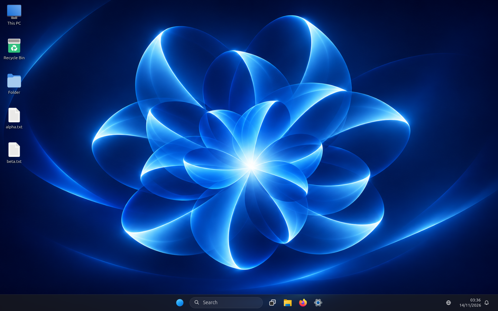
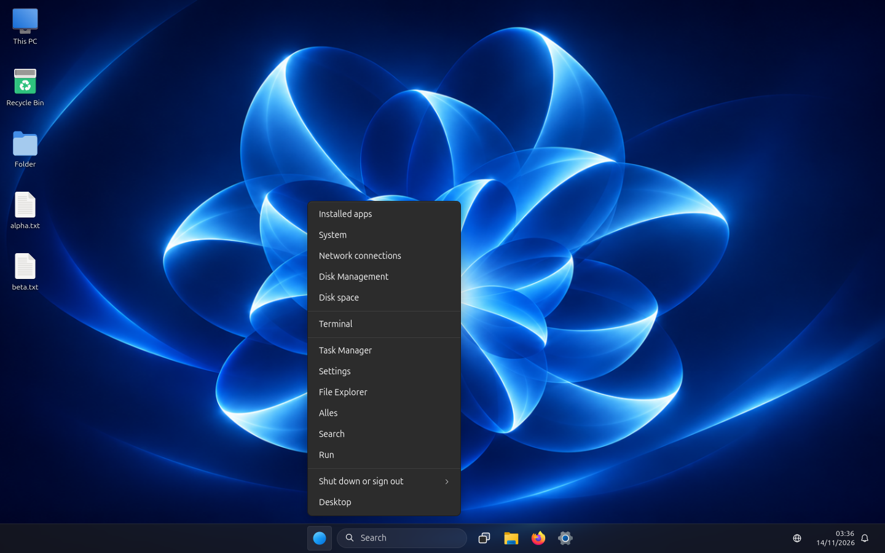
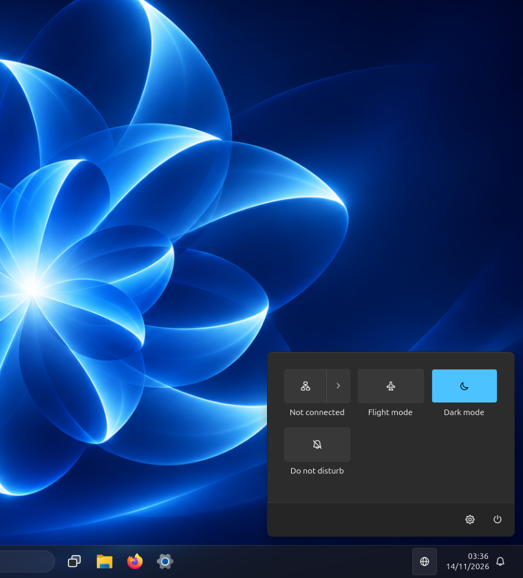
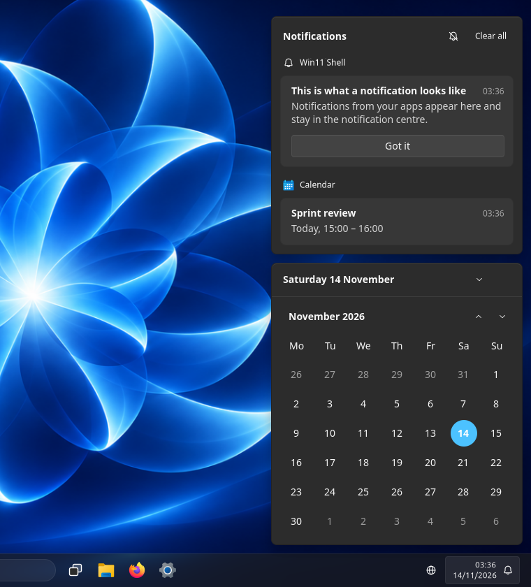
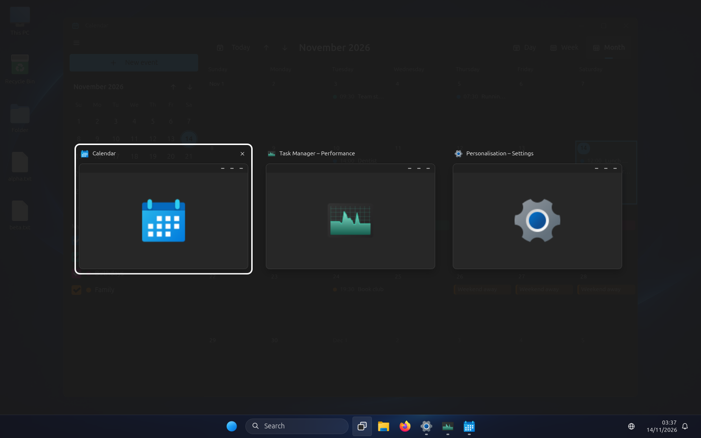
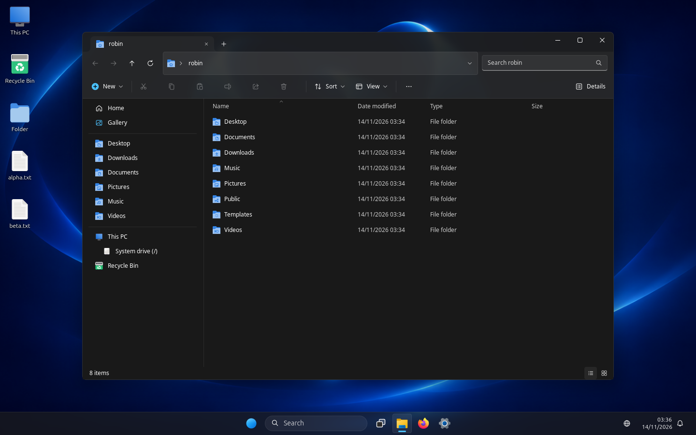
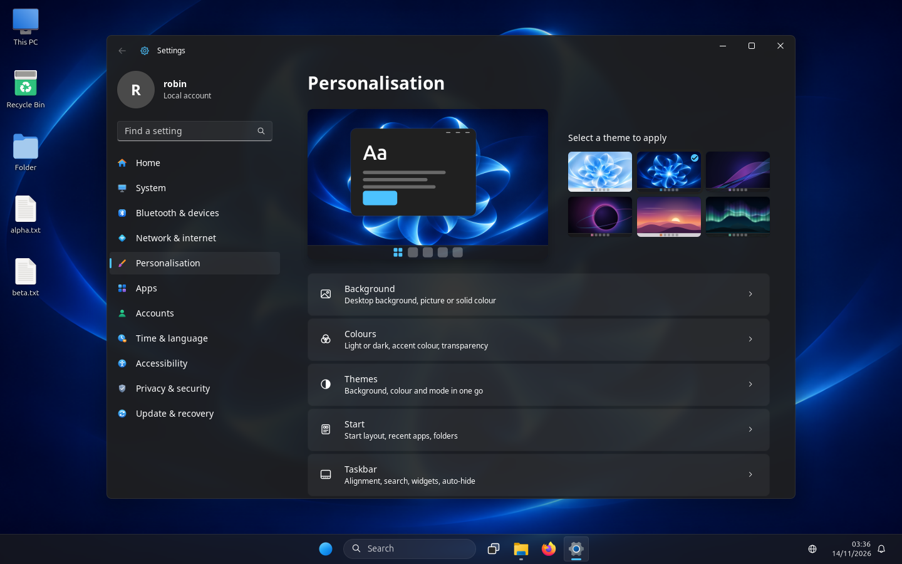
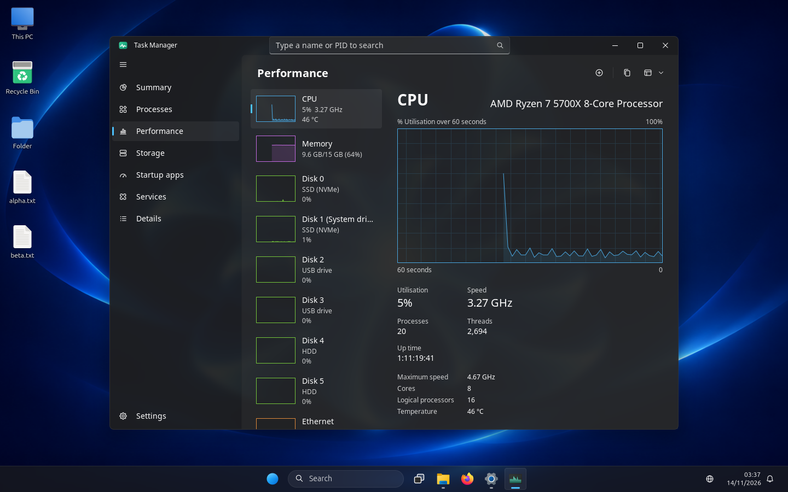
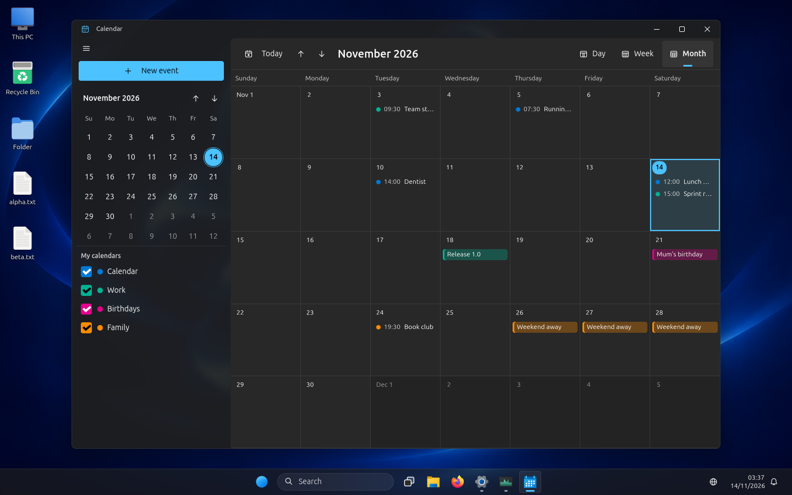
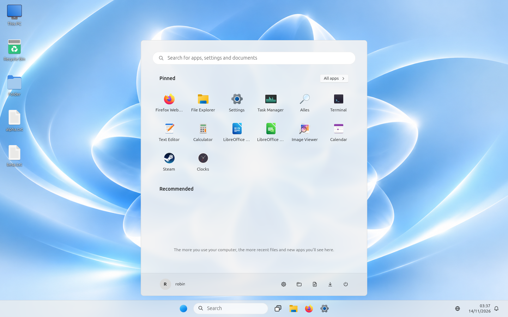

<p align="center">
  
</p>

<h1 align="center">WinPoint</h1>

<p align="center">
  <strong>Een shell in de stijl van Windows 11 voor GNOME, in Rust en GTK 4</strong>
</p>

<p align="center">
  <a href="#schermafbeeldingen">Schermafbeeldingen</a> ·
  <a href="#mogelijkheden">Mogelijkheden</a> ·
  <a href="#zo-werkt-het">Zo werkt het</a> ·
  <a href="#bouwen">Bouwen</a> ·
  <a href="#installeren-en-openen">Installeren</a> ·
  <a href="#stand-en-bekende-tekortkomingen">Stand</a> ·
  <a href="README.md">English</a>
</p>

WinPoint maakt van GNOME 50 een bureaublad in de stijl van Windows 11: een gecentreerde taakbalk, Start, snelle instellingen, een meldingencentrum met agenda, het Win+X-menu, de taakweergave en een bureaublad met pictogrammen. De shell is één native GTK 4-programma in Rust (`win11-shell`, GTK 4.22 met gtk4-rs). Een GNOME Shell-extensie koppelt het aan GNOME: die zet de vensters op hun plaats, legt het matglas van GNOME zelf eronder en regelt de sneltoetsen en vensteracties. WinPoint heeft eigen apps (Verkenner, Instellingen, Taakbeheer en meer) en een Agenda, ook allemaal native GTK 4-programma's in Rust; er zit geen webengine in.

> [!NOTE]
> WinPoint is een ontwikkelversie (0.8.0); er is nog geen openbare uitgave. Het wordt gebouwd en getest op Ubuntu 26.04 met GNOME Shell 50 op Wayland. Het project begon als "Win11 voor GNOME"; daarom houden de programma's, paden en de extensie hun `win11`-namen.

Dit is de Nederlandse versie; [README.md](README.md) (Engels) is de hoofd-README.

## Schermafbeeldingen

Alle schermafbeeldingen komen uit een afgeschermde GNOME 50-sessie zonder beeldscherm, op 1440×900 en in het Engels; op de laatste na in het donkere thema.

<table>
  <tr>
    <td align="center" width="50%"><br><sub><b>Bureaublad</b>: de Lotus-achtergrond, bureaubladpictogrammen en de taakbalk</sub></td>
    <td align="center" width="50%"><br><sub><b>Win+X-menu</b>: rechtsklik op de Startknop</sub></td>
  </tr>
  <tr>
    <td align="center"><br><sub><b>Snelle instellingen</b>: hier zonder netwerk of geluid, zoals in de testsessie</sub></td>
    <td align="center"><br><sub><b>Meldingen en agenda</b>: klik op een dag om die in Agenda te openen</sub></td>
  </tr>
  <tr>
    <td align="center"><br><sub><b>Taakweergave</b>: Alt+Tab of de knop op de taakbalk</sub></td>
    <td align="center"><br><sub><b>Verkenner</b>: tabbladen, navigatiedeelvenster en bestandsacties</sub></td>
  </tr>
  <tr>
    <td align="center"><br><sub><b>Instellingen</b>: de pagina Persoonlijke instellingen</sub></td>
    <td align="center"><br><sub><b>Taakbeheer</b>: de pagina Prestaties</sub></td>
  </tr>
  <tr>
    <td align="center"><br><sub><b>Agenda</b>: de native GTK 4-app Agenda, maandweergave</sub></td>
    <td align="center"><br><sub><b>Licht thema</b>: Start met de lichte Lotus-achtergrond</sub></td>
  </tr>
</table>

## Mogelijkheden

- **Taakbalk**: vastgemaakte en geopende apps met groepering en jump lists, pictogrammen in het systeemvak, klok en datum, gecentreerd of links uitgelijnd, desgewenst automatisch verbergen.
- **Start**: vastgemaakte apps, Alle apps, aanbevolen bestanden, het gebruikers- en het energiemenu, en zoeken in apps, instellingen, bestanden en op internet.
- **Snelle instellingen**: wifi, Bluetooth, vliegtuigmodus, donkere modus, niet storen, schuifregelaars voor helderheid en volume, en mediabediening.
- **Meldingen en agenda**: een meldingencentrum met pop-upmeldingen, en een maandagenda die de gekozen dag in de Agenda-app opent.
- **Win+X-menu**: het menu met snelkoppelingen, geopend met een rechtsklik op de Startknop.
- **Taakweergave**: elk geopend venster als kaart, met Alt+Tab of de knop op de taakbalk.
- **Bureaublad**: achtergrond, Deze pc en Prullenbak, je eigen bureaubladbestanden, contextmenu's, hernoemen, slepen om te verplaatsen en ongedaan maken.
- **Matglas**: de eigen vervaging van GNOME Shell onder de taakbalk, Start en het actieve WinPoint-appvenster; uit met Transparantie-effecten uit of met hoog contrast.
- **Windows-vensterknoppen voor GTK-apps**: minimaliseren, maximaliseren en sluiten in de stijl van Windows 11, ook voor andere GTK 3- en GTK 4-apps (Snap- en Flatpak-apps houden hun eigen knoppen).
- **Vastklikvoorbeeld in de accentkleur**: het voorbeeld dat GNOME toont als je een venster tegen een schermrand klikt, volgt je accentkleur in plaats van het oranje van Ubuntu.
- **Eigen apps**: Verkenner, Instellingen, Taakbeheer, Alles (direct zoeken in bestanden), Schijfbeheer, Standaardapps en App-installatie, elk een native GTK 4-programma.
- **Bestandskiezer**: in de WinPoint-sessie krijgen apps die de desktopportal gebruiken Verkenner als venster voor openen en opslaan.
- **Native Agenda**: een GTK 4-agenda met dag-, week- en maandweergave, lokale afspraken en de agenda's van GNOME (alleen lezen).
- **Nederlands en Engels**: een eigen taalinstelling, los van die van GNOME; elk geopend WinPoint-venster schakelt meteen om.

De Windows-toets opent Start, Alt+Tab opent de taakweergave en Ctrl+Alt+Delete opent Taakbeheer. Zet je de extensie uit, dan krijgt GNOME deze toetsen terug.

## Zo werkt het

Als de extensie aan staat, start ze `win11-panel`, dat zichzelf vervangt door `win11-shell`. Taakbalk, flyouts, Start en bureaublad zijn vensters van dat ene GTK 4-proces, dus Start openen start geen nieuw proces. De shell start `win11-panel --http-only` als backend: de Rust-diensten van de host voor apps en vastgemaakte items, instellingen, het systeemvak, meldingen, geluid, netwerk, energie en bestanden, zonder venster en bereikbaar via een lokale JSON-API met eventstream. De extensie draait in GNOME Shell en praat met de shell via D-Bus (`io.github.win11shell.GnomeBridge`): ze zet de taakbalk, Start en het bureaublad op hun plaats, verbergt de bovenbalk van GNOME en de bureaubladpictogrammen van Ubuntu, voegt het matglas toe en geeft vensters de focus. Ontbreekt `win11-shell` of valt die uit, dan komen de bovenbalk van GNOME en de eenvoudige noodtaakbalk van de extensie terug (bij het aanmelden na 6 seconden, anders meteen), en de Windows-toets of Alt+Tab start de taakbalk opnieuw. De extensie uitzetten herstelt het gewone GNOME-bureaublad. Andere dockextensies zet de installatie niet uit.

De code staat in twee Cargo-workspaces: de host in de hoofdmap (de diensten, backends, starters, hulpprogramma's en de bestandskiezer voor de portal; die linkt GLib, GIO en GDK Pixbuf en geen GTK) en `native/` (de GTK 4-programma's: `win11-shell`, `win11-calendar` en de zeven apps op hun gedeelde kit). gtk4-rs 0.11 heeft een nieuwere glib nodig dan de host, en Cargo staat één `glib-sys` per workspace toe. De eerdere HTML-versies in WebKitGTK zijn verwijderd: die van taakbalk, Start en bureaublad op 13 november 2026, die van de apps op 14 november. De laatste commit met de HTML-apps heeft de tag `last-webkit`; wat oudere rapporten over WebKit zeggen, geldt alleen voor die versies.

### Zelfstandige programma's

| Programma | Gestart als | Functie |
|---|---|---|
| `win11-panel` | | Start `win11-shell`; met `--http-only` levert het de diensten van de shell (apps, instellingen, systeemvak, meldingen, geluid, netwerk, energie, bestanden), zonder venster |
| `win11-shell` | | De GTK 4-shell: taakbalk, flyouts (snelle instellingen, meldingen en agenda, jump lists, Win+X, taakweergave), Start en zoeken, het bureaublad met pictogrammen en bestandsacties |
| `win11-gtk-explorer` | `win11-explorer` | Verkenner, met tabbladen die je tussen vensters kunt overzetten; ook de bestandskiezer |
| `win11-gtk-settings` | `win11-app --app settings` | Instellingen |
| `win11-gtk-taskmgr` | `win11-app --app taskmgr` | Taakbeheer |
| `win11-gtk-alles` | `win11-app --app alles` | Alles, met een eigen indexproces zolang de app open is |
| `win11-gtk-disks` | `win11-app --app disks` | Schijfbeheer |
| `win11-gtk-defaultapps` | `win11-default-apps` | Standaardapps per bestandstype of extensie |
| `win11-gtk-installer` | `win11-installer` | App-installatie: installeert en verwijdert AppImage-, DEB-, Flatpak- en Snap-pakketten, elk na een uitdrukkelijke bevestiging |
| `win11-calendar` | | Agenda (GTK 4), geopend op een dag vanuit de agenda van de taakbalk |
| `win11-file-portal` | | Een FileChooser-backend voor `xdg-desktop-portal`, die op verzoek start |

De starters in de middelste kolom zijn wat de app-items, de shell en de bestandskoppelingen uitvoeren. Elke starter start zichzelf opnieuw in een eigen tijdelijke systemd-gebruikersservice (`app-win11-<soort>-….service` in `app.slice`, als de systemd-gebruikersbeheerder beschikbaar is) en vervangt zich daar door zijn app; die app start zijn eigen backend, `win11-app --app <soort> --http-only`, en praat daarmee zoals de shell met de zijne. Vensteracties en het matglas gaan rechtstreeks via D-Bus naar de extensie. Ontbreekt het programma van een app, dan noemt de starter het bestand, vraagt om WinPoint opnieuw te installeren en stopt met code 127. `win11-launch` (draait ook bij elke aanmelding bij GNOME een korte controle na Ubuntu-upgrades), `win11-index-worker`, `win11-image-worker` en `win11-software-worker` zijn interne hulpprogramma's. Met de starters en deze hulpprogramma's erbij zijn het 19 programma's. Een app heeft geen zichtbare taakbalk nodig. Tabbladen zijn ook tussen bestaande Verkenner-vensters over te zetten; voor het loslaten van een tabblad op het bureaublad en de echte schermpositie is de GNOME-extensie nodig.

## Bestanden, apps en instellingen

De bestandskern van Verkenner omvat navigeren, metadata, zoeken, mappen volgen, openen met, aanmaken, hernoemen, kopiëren en verplaatsen, het klembord, de Prullenbak, ZIP- en TAR-archieven en eigenschappen. Archieven gebruiken `libarchive`; de Prullenbak en de koppelingen tussen apps en bestandstypen gebruiken GIO. Een bestandsactie overschrijft nooit ongevraagd een bestaand bestand. Bewaarde instellingen staan in bestanden die alleen jij kunt lezen, worden in één keer weggeschreven en gebruiken gedeelde bestandsvergrendeling.

**Instellingen › Systeem › Energie en batterij** regelt de energiestand, het uitschakelen van het scherm, dimmen en automatisch slapen op netstroom of batterij. De Rust-dienst gebruikt dezelfde GNOME-voorkeuren en PowerProfiles-dienst als Ubuntu. Bestaande aangepaste tijden en ‘Nooit’ blijven behouden; wijzigingen vanuit GNOME verschijnen ook in dit venster. Per instelling is te zien of die beschikbaar is of door een beheerder is vergrendeld. Batterijopties verschijnen alleen wanneer er een batterij is.

De appfuncties, recente bestanden en de appcatalogus draaien in Rust. **Standaardapps** is een apart programma: je zoekt op extensie of MIME-type en koppelt precies dat bestandstype aan een geïnstalleerde app die het kan openen. Daarna leest het terug welke app werkelijk de standaard is. Openen of installeren verandert deze koppelingen niet vanzelf.

Gewone appvensters onthouden hun afmetingen en of ze gemaximaliseerd waren (`native-windows.json`); de plaats bepaalt GNOME. Verkenner onthoudt daarnaast de toestand van maximaal twintig tabbladen, zoals de geopende map (`window-state.json`, hetzelfde bestand als eerdere versies, zodat hun tabbladen terugkomen). Een pad dat je bij het openen meegeeft of een overgezet tabblad gaat voor. Start, de taakbalk, het bureaublad en de bestandskiezer vallen hierbuiten; de kiezer onthoudt alleen zijn eigen grootte.

Het detailvenster van Verkenner vraagt alleen een videominiatuur voor de geselecteerde video die zichtbaar is. Bestaande miniaturen in de freedesktop-cache worden hergebruikt; anders maakt een kortlevend hulpprogramma met FFmpeg één stilstaand beeld. Er draait geen videospeler op de achtergrond. Zonder geschikte decoder of bij een fout blijft het gewone bestandspictogram staan. Zie [host/src/images/README.md](host/src/images/README.md).

## Apps installeren en verwijderen

App-installatie herkent AppImage, DEB, Flatpak (verwijzingen en bundels) en Snap. Bij het bekijken voert het een gedownloade AppImage niet uit. Een installatievoorstel bewaart een eigen kopie van het pakket waar alleen WinPoint bij kan; pas een aparte bevestiging voert dat ene voorstel uit. Voorstellen verlopen na tien minuten, en er loopt hooguit één softwarewijziging tegelijk. De status en een annulering blijven ook voor andere vensters zichtbaar; een uitkomst die onbekend bleef, wordt als onderbroken gemeld.

AppImages krijgen een beheerde kopie onder `~/.local/opt/win11shell-appimages` en een eigen starter. Het gedownloade bestand blijft staan. Verwijderen haalt alleen de geregistreerde kopie en starter weg; onverwachte extra bestanden blijven staan. Bij een losse starter van de gebruiker heet de actie **Snelkoppeling verwijderen** en blijven de appbestanden staan.

DEB-pakketten gaan via PackageKit, met eerst een proefronde; een wijziging die daarbij ook andere of beschermde pakketten zou verwijderen, wordt geweigerd. Snap gebruikt de API van snapd, met voortgang en annuleren. Flatpak krijgt vaste argumenten en de gebruikers- of systeeminstallatie die bij het pakket hoort. Om een wachtwoord vraagt het besturingssysteem zelf; WinPoint verzamelt geen wachtwoorden. Persoonlijke Flatpak-gegevens blijven bij verwijderen staan, en Snap-verwijdering gebruikt geen purge.

## Bestandskiezer via desktopportals

`win11-file-portal` levert OpenFile, SaveFile en SaveFiles achter `xdg-desktop-portal`. Per aanvraag toont het Verkenner als kiezer (`win11-gtk-explorer --picker-stdio`), en de host controleert de keuze. Alleen deze FileChooser-backend wordt gekozen; de portal zelf blijft verantwoordelijk voor de identiteit van de app en de toegang tot documenten. De kiezer maakt of overschrijft het gekozen bestand niet zelf.

Apps moeten de desktopportal gebruiken om deze kiezer te zien; de eigen apps doen dat (ze zetten `GDK_DEBUG=portals`). Een app met een eigen ingebouwde kiezer houdt die. In de WinPoint-sessie is dit de bestandskiezer, na een installatie met `--no-session` ook in je gewone GNOME-sessie (zie [Installeren en openen](#installeren-en-openen)). De backend stopt na vijftien seconden zonder aanvragen; zelf draait hij geen GTK, alleen het kiezerproces per aanvraag. Details en de grenzen van het protocol staan in [host/src/portal/README.md](host/src/portal/README.md).

## Geheugen en matglas

Diensten starten pas wanneer een onderdeel ze nodig heeft. De Alles-indexer is een apart Rust-proces en hoort alleen bij de geopende Alles-app; de eerdere v2-indexcache blijft bruikbaar. Gewone apps zijn losse processen, elk met een eigen backend.

In een afgeschermde GNOME-sessie zonder beeldscherm, op 1440×900 met softwarerendering, gebruikten `win11-shell`, zijn backend en de SVG-lader van GTK samen **126 MiB PSS en 93 MiB anoniem geheugen plus swap** met de definitieve build (14 november; een tweede meting die dag gaf 144 en 110 MiB). Op 12 november, in één sessie met beide versies, gebruikte de eerste native build 119 en 76 MiB, tegen 443 en 269 MiB voor de eerdere WebKit-taakbalk, -Start en -bureaublad met al hun WebKit-processen (`tests/gnome/scenarios/native-shell.py`). De shell gebruikt standaard de cairo-renderer van GTK (`GSK_RENDERER=cairo`); met de GL-renderer (llvmpipe) gebruikte die eerste build 244 en 113 MiB. PSS telt gedeeld geheugen naar verhouding mee en verschilt van een opgetelde RSS-kolom.

De apps, op dezelfde manier gemeten, elk met zijn eigen backend (`tests/gnome/scenarios/native-gtk-apps.py`, PSS):

| App | GTK 4-app, definitieve build (14 nov) | GTK 4-app, 13 nov | WebKit-app, 13 nov |
|---|---|---|---|
| Verkenner | 42 MiB | 52 MiB | 220 MiB |
| Instellingen | 91 MiB | 102 MiB | 242 MiB |
| Taakbeheer | 49 MiB | 59 MiB | 220 MiB |
| Alles | 73–143 MiB | | |
| Schijfbeheer | 30 MiB | | |
| Standaardapps | 41 MiB | | |
| App-installatie | 29 MiB | | |

De eerste kolom is de definitieve build zonder WebKit; Alles wisselt met hoe ver zijn index is. De andere twee kolommen komen uit één sessie op 13 november waarin beide versies van de drie apps draaiden, vóór de laatste correcties aan de GTK 4-apps; een WebKit-app had daarbij ook zijn web- en netwerkproces. Deze metingen omvatten geen geheugen van de compositor of de GPU en komen uit testsessies: zie ze als een indicatie, niet als een garantie. Zie [notes/claude/gtk-native.md](notes/claude/gtk-native.md).

De backend van de shell (`win11-panel --http-only`) draait in een eigen begrensde systemd-groep (`app-win11shell.slice`) wanneer de systemd-gebruikersbeheerder beschikbaar is; `win11-shell` zelf valt daar nog buiten. Gestarte apps draaien elk in een eigen groep.

Matglas komt van GNOME Shell zelf, niet van GTK: onder de taakbalk, onder het geopende Startmenu en onder het actieve eigen appvenster, met deze dekking (taakbalk 70 %, appvensters en Start 90 %). Er is hooguit één vensterblur tegelijk; een gesloten Start houdt er geen vast. In een afgeschermde 1440×900-sessie met softwarerendering kostte dat gnome-shell 3,8 MiB PSS met Instellingen en 8,9 MiB met Start open, nog gemeten met de WebKit-Start (`tests/gnome/scenarios/frosted-glass.py`). Met Transparantie-effecten uit of hoog contrast blijft alles dekkend.

## Vereisten

- Ubuntu 26.04 met GNOME Shell 50 op Wayland. Dat is het enige geteste systeem; een andere distributie met GNOME 50 en GTK 4.22 kan werken, maar is niet geprobeerd.
- Om te bouwen: Rust 1.92 of nieuwer (edition 2024), een C/C++-bouwomgeving, `pkg-config` en de ontwikkelbestanden van GLib 2.70 of nieuwer, GDK Pixbuf en GTK 4.22 of nieuwer.
- Om te draaien: GTK 4 (met Pango, graphene en cairo), GLib en GDK Pixbuf, `libarchive.so.13` (archieven in Verkenner), en Python 3 met PyGObject (`python3-gi`) en `glib-compile-schemas` (`libglib2.0-bin`) voor installeren en verwijderen. De installer controleert dat vooraf en noemt de ontbrekende Ubuntu-pakketten. WebKitGTK en GTK 3 zijn niet nodig.
- Optioneel: FFmpeg en FFprobe voor videominiaturen; PackageKit, Flatpak of snapd voor App-installatie, met `dpkg-deb` en `unsquashfs` (squashfs-tools) voor de gegevens van DEB- en Snap-pakketten; bubblewrap om de decoders voor metadata en afbeeldingen af te schermen.

Netwerk, geluid, opslag, energie en meldingen gebruiken de gewone Linux- en GNOME-diensten. Python gebruikt WinPoint verder voor de pakkettools en sommige ontwikkeltests; de shell en de apps starten geen Python-backend. Het pakket bundelt geen Python-omgeving en geen kopieën van systeembibliotheken. De oorspronkelijke Python-diensten in `vendor/host` blijven als referentie voor vergelijkende tests en worden niet geïnstalleerd.

## Bouwen

Haal de broncode op met git en bouw hem. Elke opdracht na `cd WinPoint`, hier en in de rest van deze README, voer je uit in de hoofdmap van de werkmap:

```bash
sudo apt install git build-essential pkg-config cargo libglib2.0-dev libgdk-pixbuf-2.0-dev libgtk-4-dev libarchive13t64
git clone https://github.com/roboburr/WinPoint.git
cd WinPoint
cargo fetch --locked
cargo fetch --locked --manifest-path native/Cargo.toml
./scripts/build.sh
```

De `cargo` van Ubuntu 26.04 is Rust 1.93; een toolchain via rustup kan ook. `./scripts/build.sh` bouwt de host (de workspace in de hoofdmap) en daarna de native workspace `native/` met `win11-shell`, `win11-calendar` en de zeven apps: samen 19 programma's in `target/release` (of in `$CARGO_TARGET_DIR/release` als die gezet is). Beide bouwen offline en `--locked`; `cargo fetch` haalt de crates daarom vooraf één keer op. `build.sh` bouwt standaard met twee taken tegelijk; zet `WIN11_BUILD_JOBS` voor meer.

Crates en bouwuitvoer mogen elders staan, bijvoorbeeld op een andere schijf, met de gewone Cargo-variabelen. Zet die dan al vóór `cargo fetch` en geef de installer de map met de programma's:

```bash
export CARGO_HOME=/absoluut/pad/cargo-home CARGO_TARGET_DIR=/absoluut/pad/target
cargo fetch --locked
cargo fetch --locked --manifest-path native/Cargo.toml
./scripts/build.sh
WIN11_BUILD_DIR="$CARGO_TARGET_DIR/release" ./scripts/install.sh
```

## Installeren en openen

Bouw eerst (zie [Bouwen](#bouwen)): de installer compileert niets. Hij kopieert alle 19 programma's uit één map: uit `$WIN11_BUILD_DIR` als die gezet is, anders uit `target/release` (daar zet `scripts/build.sh` ze) of uit `bin/` (de map van een archief van `scripts/package.sh`), welke van de twee alle 19 bevat. Staat `CARGO_TARGET_DIR` elders, geef de map dan mee: `WIN11_BUILD_DIR="$CARGO_TARGET_DIR/release" ./scripts/install.sh`.

```bash
./scripts/build.sh
./scripts/install.sh
```

Zonder complete build stopt de installer voordat er iets verandert, met een regel per ontbrekend programma, bijvoorbeeld `Ontbreekt: …/target/release/win11-explorer. Bouw eerst met scripts/build.sh.` Die map mist dan deze programma's: bouw met `./scripts/build.sh`, of zet `WIN11_BUILD_DIR` op de map van je build. Noemen de regels `bin/`, dan is er in de werkmap nog helemaal geen `target/release`, alleen een oude map `bin/`, en die gebruikt de installer alleen als alle 19 programma's erin staan.

De installer controleert eerst de vereiste programma's en bibliotheken en installeert dan voor jouw gebruiker: de programma's in `~/.local/bin`, de rest in `~/.local/share/win11-gnome`, en de app-items, pictogrammen en de extensie onder `~/.local/share`. Onder `~/.config` komen een autostart-item voor de controle na Ubuntu-upgrades (met de inlogkeuze nog een tweede, dat in de andere sessies GNOME's uiterlijk terugzet) en de portalinstellingen en systemd-gebruikersunit van de bestandskiezer. Bestaande persoonlijke instellingen blijven behouden. WinPoint installeert geen GTK-thema: apps houden het GTK-thema van je systeem, waarvan WinPoint alleen de lichte of donkere variant kiest. De installer kiest geen nieuwe standaardbestandsbeheerder en zet geen standaardapps, behalve de koppeling voor zijn eigen `win11-calendar:`-links (één regel in `~/.config/mimeapps.list`, die verwijderen weer weghaalt).

Een installatie over een eerdere versie met de WebKit-shell verwijdert de oude `win11-start` en `win11-desktop` met hun app-items. Een update van een versie met de WebKit-apps verwijdert ook hun gegevens (opslag en caches onder `~/.local/share` en `~/.cache`, alleen mappen met uitsluitend hun bestanden) en noemt elk verwijderd pad.

WinPoint wordt een eigen keuze bij het inloggen, naast GNOME en Ubuntu. Daarvoor start de installer `scripts/install-session.py`, dat vier kleine systeembestanden plaatst (een sessie voor GDM, een gnome-session-sessie, de systemd-aanvulling daarvan en een sessiemodus voor GNOME Shell). `pkexec` vraagt één keer om je wachtwoord. Meld je daarna af, klik op je naam, kies **WinPoint** met het tandwiel rechtsonder en meld je aan.

- **WinPoint** is GNOME met de WinPoint-shell. De sessiemodus zet de extensie aan, zonder Ubuntu Dock, en de bestandskiezer van WinPoint is daar de standaard.
- **GNOME** en **Ubuntu** blijven zoals ze waren. Bij elke aanmelding daar zet WinPoint terug wat het in GNOME veranderde (thema, pictogrammen, kleurenschema, achtergrond, vensterknoppen en de CSS voor de vensterknoppen) en zet het zijn extensie uit.

`--no-session` slaat deze stap over; dan is er geen wachtwoord nodig (zonder terminal, gnome-session of pkexec slaat de installer hem ook over, zonder melding). Dat werkt alleen zolang de inlogkeuze er nog niet is; haal hem anders eerst weg met `python3 scripts/install-session.py --remove`. WinPoint draait dan in je gewone GNOME-sessie: meld je één keer af en weer aan zodat GNOME Shell de nieuwe extensie laadt, en zet hem aan:

```bash
gnome-extensions enable win11-gnome@win11shell.local
```

Ubuntu Dock blijft dan aan en kan naast de taakbalk zichtbaar zijn; `gnome-extensions disable ubuntu-dock@ubuntu.com` zet hem uit. De bestandskiezer van WinPoint wordt dan ook het open- en opslagvenster van apps die de desktopportal gebruiken in die sessie, ook met de extensie uit; verwijderen maakt dat ongedaan.

In de WinPoint-sessie, of met de extensie aan in je gewone sessie, open je de apps vanuit Start. Hun starters werken in elke sessie, bijvoorbeeld:

```bash
~/.local/bin/win11-explorer /pad/naar/map
~/.local/bin/win11-app --app settings
~/.local/bin/win11-default-apps
```

De inlogkeuze kan ook later, en weer weg (`--dry-run` laat zien wat er zou gebeuren):

```bash
python3 scripts/install-session.py
python3 scripts/install-session.py --remove
```

Start daarna `./scripts/install.sh` opnieuw (na weghalen met `--no-session`), zodat de installer je eigen bestanden erop afstemt: het autostart-item dat GNOME's uiterlijk terugzet en de portalkeuze van de bestandskiezer.

<details>
<summary>Andere installatiepaden en optionele systeembestanden</summary>

`WIN11_INSTALL_PREFIX` bepaalt waar `bin/` en `share/win11-gnome/` komen, en `XDG_DATA_HOME` waar de app-items, pictogrammen en de extensie komen. Gebruik absolute paden, en dezelfde waarden bij verwijderen. Dit is geen tweede installatie naast de standaardinstallatie: app-items, extensie en autostart-items zijn per gebruiker, dus zolang er een andere installatie is, weigert de installer met `Niet overschreven: bestaande bestanden zonder installatiemarker:`. Verwijder die eerst.

```bash
WIN11_INSTALL_PREFIX="/absoluut/pad/met spaties" ./scripts/install.sh
WIN11_INSTALL_PREFIX="/absoluut/pad/met spaties" ./scripts/uninstall.sh
```

De pagina Update en herstel in Instellingen werkt zonder systeembestanden. Met die bestanden zegt het wachtwoordvenster van Ubuntu wat de acties voor een release-upgrade doen. `scripts/install-system.py` installeert of verwijdert precies die vier bestanden (twee hulpprogramma's in `/usr/libexec/win11-gnome` en twee polkit-regels); `pkexec` vraagt om het wachtwoord, en `--dry-run` laat zien wat het zou doen:

```bash
python3 scripts/install-system.py --dry-run
python3 scripts/install-system.py
python3 scripts/install-system.py --remove
```

</details>

## Verwijderen

```bash
./scripts/uninstall.sh
```

Dat zet de extensie uit, verwijdert de bestanden die de installer als eigen markeerde en maakt de bestandskiezer en de `win11-calendar:`-koppeling ongedaan. De inlogkeuze WinPoint blijft tot je hem weghaalt met `python3 scripts/install-session.py --remove`. Je instellingen in `~/.config/win11-gnome` blijven staan. `--files-only` is voor geïsoleerde testinstallaties: het verwijdert de bestanden zonder de desktopsessie aan te raken.

Met de inlogkeuze WinPoint zet verwijderen ook GNOME's eigen uiterlijk terug (thema, pictogrammen, kleurenschema, achtergrond, vensterknoppen en de CSS voor de vensterknoppen). Na een installatie met `--no-session` zet het alleen het pictogramthema terug. GNOME houdt dan het GTK-thema, het kleurenschema en de vensterknoppen die WinPoint instelde, de vensterknoppen voor andere GTK-apps blijven als importregel in `~/.config/gtk-3.0/gtk.css` en `~/.config/gtk-4.0/gtk.css` staan, en met een ingebouwde WinPoint-achtergrond wijst de achtergrond van GNOME naar een bestand dat weg is. Zet bij zo'n installatie daarom vóór het verwijderen **Instellingen › Persoonlijke instellingen › Kleuren › Windows 11-vensterknoppen in apps** uit. Kies daarna je stijl en achtergrond opnieuw bij Uiterlijk in de Instellingen van GNOME; `gsettings reset org.gnome.desktop.wm.preferences button-layout` geeft de vensterknoppen terug.

## Taal

WinPoint heeft een eigen taalinstelling, Nederlands of Engels, los van de taal van GNOME en Ubuntu. Bij een eerste installatie zonder `--lang nl` of `--lang en` raadt de installer de taal uit je systeem: een Nederlandse taalinstelling, de C-locale, of een Engelse met Nederlandse notaties of een Nederlandse tijdzone geeft Nederlands, anders Engels. Een taal die al in `settings.json` staat, blijft altijd gelden:

```bash
./scripts/install.sh --lang en
```

Later kies je de taal in **Instellingen › Tijd en taal › Taal en regio**. Alle geopende WinPoint-vensters schakelen meteen om: taakbalk, Start, bureaublad, Verkenner, de apps en hun venstertitels, ook bureaubladlabels zoals Prullenbak (Recycle Bin). De backend van de shell (`win11-panel --http-only`) past ook de namen van de eigen app-items aan, zodat GNOME die in dezelfde taal toont. Meldingen die al binnen waren, houden hun taal.

Een paar teksten komen niet van WinPoint en blijven in de taal van GNOME of het systeem: de wachtwoordvensters van polkit, berichten en pakketbeschrijvingen van PackageKit, teksten van NetworkManager, de eigen teksten van GTK (zoals het contextmenu van een tekstveld) en de onderdelen van GNOME zelf, zoals de snelle instellingen en GNOME's melding dat een venster klaarstaat (in een Engelstalige GNOME: “X” is ready). Alles heet in beide talen Alles, en mappen op schijf, zoals Bureaublad en Documenten, worden nooit hernoemd.

## Configuratie

Je stelt alles in met de app Instellingen. Die bewaart de keuzes in `~/.config/win11-gnome/settings.json` (of `$XDG_CONFIG_HOME/win11-gnome/settings.json`); de backend merkt wijzigingen in het bestand op, ook als je het met de hand bewerkt. De standaardwaarden staan in [host/src/settings-defaults.json](host/src/settings-defaults.json). De belangrijkste sleutels:

| Sleutel | Waarden | Wat het doet |
|---|---|---|
| `language` | `"nl"`, `"en"` | De taal van alle WinPoint-vensters (Instellingen › Tijd en taal › Taal en regio) |
| `theme.mode` | `"dark"`, `"light"` | Donker of licht thema |
| `theme.accent` | `"#0067c0"` | De accentkleur |
| `theme.transparency` | `true`, `false` | Matglas (Transparantie-effecten) |
| `theme.captionButtons` | `true`, `false` | Windows 11-vensterknoppen in andere GTK-apps |
| `taskbar.alignment` | `"center"`, `"left"` | Uitlijning van de taakbalk |
| `taskbar.search` | `"box"`, `"iconLabel"`, `"icon"`, `"hidden"` | Het zoekvak op de taakbalk |
| `taskbar.pinned` | id's van desktopbestanden | De apps die aan de taakbalk zijn vastgemaakt |
| `taskbar.autoHide` | `true`, `false` | De taakbalk automatisch verbergen |
| `start.pinned`, `start.showRecommended` | lijst, `true`/`false` | De vastgemaakte apps van Start en het gedeelte Aanbevolen |
| `wallpaper.path` | `"builtin:lotus-dark"` of een bestand | De achtergrond; met `wallpaper.followTheme` volgt een ingebouwde achtergrond het lichte of donkere thema |
| `desktop.showIcons` | `true`, `false` | Bureaubladpictogrammen |
| `time.h24`, `time.firstDayOfWeek` | `true`/`false`, `1` = maandag | De klokweergave en de eerste weekdag van de agenda op de taakbalk |
| `notifications.dnd` | `true`, `false` | Niet storen |

De GTK 4-programma's gebruiken de cairo-renderer van GTK, die het minste geheugen vraagt, tenzij `GSK_RENDERER` gezet is of `WIN11_SHELL_GL=1`, `WIN11_CALENDAR_GL=1` of `WIN11_APP_GL=1` om de standaard van GTK vraagt; programma's die WinPoint start, krijgen je eigen `GSK_RENDERER` terug. De schakelaars van de eerdere HTML-versies in WebKitGTK (`~/.config/win11-gnome/no-gpu`, `WIN11SHELL_GPU`, `WIN11_WEBKIT_BROWSER_CACHE`) doen niets meer.

## Ontwikkeling en tests

```text
native/shell/     win11-shell: src/panel/ (taakbalk), src/flyouts/, src/start/, src/desktop/, css/
native/calendar/  win11-calendar
native/apps/      de zeven apps, elk een eigen crate (win11-gtk-<soort>)
native/kit/       wat de apps delen: backendclient, instellingen, thema, vensterkader, bedieningselementen
host/             de Rust-host: diensten en JSON-API, starters, bestandskiezer voor de portal, hulpprogramma's, i18n-tabellen
extension/        de GNOME Shell-extensie (paneel, matglas, sneltoetsen, meldingen, bureaublad)
vendor/ui/        de achtergronden en het pictogram van Instellingen (de HTML-apps zijn weg: git-tag last-webkit)
vendor/host/      de oorspronkelijke Python-diensten, als referentie voor vergelijkende tests (niet geïnstalleerd)
vendor/config/    de stijlen van de GTK-vensterknoppen
vendor/icons/     het Win11-pictogramthema (GPL-3.0-only)
scripts/          bouwen, installeren, verwijderen, pakket maken en controles van de UI-manifesten
tests/            de GNOME-testsessie, de Rust-sandbox, de installer- en i18n-tests
notes/claude/     ontwerpnotities en het beslissingslog (plan.md)
```

[native/ARCH.md](native/ARCH.md) beschrijft hoe de modules van de shell samenhangen, [native/APPS.md](native/APPS.md) de apps en hun kit (beide in het Engels).

**Een afgeschermde GNOME-sessie voor tests.** `tests/gnome/harness.py` start een eigen GNOME Shell 50 zonder beeldscherm, met een virtuele monitor van 1440×900, in een bubblewrap-sandbox, installeert daar een build en draait er scenariobestanden tegen. Je eigen sessie kan hij niet bereiken: hij heeft een eigen thuismap, een eigen D-Bus en geen netwerk. Hij heeft `bwrap`, `dbus-run-session`, `strace`, `gnome-shell`, PyGObject en ongeveer 2,5 GB vrij geheugen nodig. Hij leest de 19 programma's uit `tests/build/native-release` in de werkmap, en `guard-selftest` doet dat altijd; `--build-dir` moet ook een map in de werkmap met alle 19 zijn (een link naar een map elders telt niet). De Rust-tests lezen standaard dezelfde map. Kopieer je build er één keer heen (uit `"$CARGO_TARGET_DIR/release"` als de build elders staat):

```bash
mkdir -p tests/build/native-release
find target/release -maxdepth 1 -type f -executable -name 'win11-*' -exec cp -t tests/build/native-release {} +
python3 -B tests/gnome/harness.py guard-selftest
python3 -B tests/gnome/harness.py launch --own-lock run --lang nl \
    --scenario tests/gnome/scenarios/native-shell.py
```

Resultaten en schermafbeeldingen komen in `tests/gnome/scenarios/native-shell.out/`. De andere scenario's staan in `tests/gnome/scenarios/`; de schermafbeeldingen in deze README komen van `readme-shots.py`. Zie [tests/gnome/README.md](tests/gnome/README.md) (in het Engels) voor alle opties en wat de sandbox bewaakt.

Andere controles:

```bash
python3 -B tools/i18n/check.py
python3 scripts/verify-ui.py
tests/rust-sandbox/run-tests.sh
```

`tools/i18n/check.py` controleert de Nederlandse en Engelse teksten. `scripts/verify-ui.py` controleert `vendor/ui`, dat sinds de verwijdering van de HTML-apps alleen nog de achtergronden en het pictogram van Instellingen bevat, tegen de bewaarde baseline en de actuele distributiemanifesten: `vendor/ui-original-sha256.json` bewaart de oorspronkelijke hashes, en `vendor/ui-sha256.json` en `vendor/ui-patches.json` beschrijven de huidige bestanden en de gerichte wijzigingen. De oorspronkelijke bronbestanden zijn dus een uitgangspunt, geen claim dat elk bestand ongewijzigd is; de wijziging `html_apps_removed` legt vast dat `index.html`, `js/`, `css/` en `assets/img/` weg zijn. `tests/rust-sandbox/run-tests.sh` draait de Rust-tests van de host in een afgeschermde sandbox. Dat script start cargo met een schone omgeving: staan je crates of bouwuitvoer elders, zet dan `WIN11_CARGO_HOME` en `WIN11_CARGO_TARGET_DIR` (niet `CARGO_HOME` en `CARGO_TARGET_DIR`); het resultaat staat in `tests/rust-sandbox/logs/test.log`.

`tests/installer/run.sh` vergelijkt de installer byte voor byte met een eerdere commit (3b898e6) en heeft daarvoor de volledige git-geschiedenis van het project nodig, die deze repository niet heeft; hij draait alleen in de werkmap van de auteur. `tools/heavy.sh` heeft als standaard nog een slotbestand op de computer van de auteur; `WIN11_HEAVY_LOCK` vervangt dat, en de harness leest die variabele ook. Zet hem op het eigen slot van de werkmap, `WIN11_HEAVY_LOCK="$(pwd -P)/.heavy.lock"` (vanuit de werkmap), het enige dat `--own-lock` van de harness aanneemt. `WIN11_GNOME_CONFIG_DIR` laat de Rust-programma's een andere instellingenmap gebruiken. Die is alleen bedoeld voor tests: de GNOME-extensie en de installer lezen altijd `$XDG_CONFIG_HOME/win11-gnome` (meestal `~/.config/win11-gnome`), dus in een gewone sessie zouden de taakbalk en de vensters elk een andere taal kunnen tonen.

De standaardinstellingen van een nieuwe installatie komen uit `host/src/settings-defaults.json`. Persoonlijke geschiedenis, accounts, indexcaches, computergebonden paden en runtime-tokens horen niet in een downloadpakket. `./scripts/package.sh` maakt na het bouwen een archief onder `dist/`, met de 19 programma's in `bin/` en ook `LICENSE`, `THIRD_PARTY_NOTICES.md` en `LICENSES/`.

## Stand en bekende tekortkomingen

WinPoint is nog in ontwikkeling. De actuele controles, hun omgeving en grenzen staan bovenaan [VALIDATION.md](VALIDATION.md); ze bewijzen de scenario's die ze noemen, niet dat alles op elke computer werkt zoals in Windows 11. De voorwaarden voor een eerste uitgave staan in [RELEASE_PLAN.md](RELEASE_PLAN.md). Oudere rapporten blijven in het project staan met hun oorspronkelijke versie en meetdatum.

Bekende tekortkomingen:

- **Twee opdrachten zonder ontvanger**: de `shell.command`-events voor **Nieuwe taak** in Taakbeheer (die het zoeken van de shell opent) en voor de knop **Openen** op de pagina Klembord van Instellingen hebben geen ontvanger in de nieuwe shell en doen dus niets.
- **Als de shell uitvalt**: ontbreekt `win11-shell` of valt die uit, dan stopt `win11-panel`; de bovenbalk van GNOME en de eenvoudige noodtaakbalk van de extensie komen terug (bij het aanmelden na 6 seconden, anders meteen), en de Windows-toets of Alt+Tab start de taakbalk opnieuw. Een ontbrekend app-programma is ook een fout: de starter noemt het en stopt met code 127; installeer WinPoint dan opnieuw.
- **Geheugengrenzen**: als de systemd-gebruikersbeheerder beschikbaar is, draait de backend van de shell in een eigen begrensde systemd-groep (`app-win11shell.slice`), maar `win11-shell` zelf valt daar nog buiten.
- **Apps**: de GTK 4-apps volgen de HTML-apps die ze vervangen scherm voor scherm, met hun pictogrammen en vensterknoppen, maar niet in elk detail: dialogen, menu's en meldingen hebben geen inloopanimatie en sommige indelingen voor smalle vensters ontbreken. [native/APPS.md](native/APPS.md) noemt de verschillen per app.
- **App-installatie**: de software-engine is getest met gegenereerde pakketten en nagebootste pakketdiensten, en de app App-installatie alleen met proefrondes, nog niet met echte installaties op een systeem.
- **Taakweergave** toont per venster het app-pictogram, geen live miniatuur.
- **Win+X** opent met een rechtsklik op Start; de toets Win+X zelf is nog niet gekoppeld.
- **Agenda**: in het Engels begint de Agenda-app de week op zondag, terwijl de agenda van de taakbalk `time.firstDayOfWeek` volgt (standaard maandag). De agenda's van GNOME en het openen van een dag vanuit de taakbalk zijn niet getest in de afgeschermde sessie.
- **Twee agenda's in Alle apps**: met GNOME Agenda geïnstalleerd tonen Alle apps in Start (en het appoverzicht van GNOME) die en de Agenda van WinPoint onder dezelfde naam ("Agenda", in het Engels "Calendar").
- **Nachtlampje en beeldschermen**: het nachtlampje staat niet in de snelle instellingen en Instellingen toont de beeldschermen alleen grijs; beide stel je in via de eigen Instellingen van GNOME.
- **Uitgavearchief**: het archief van `scripts/package.sh` bevat nog `vendor/host`, de Python-referentie, die de installer niet installeert.
- **Logmeldingen**: de apps zetten zelf `GDK_DEBUG=portals`; in een sessie zonder `xdg-desktop-portal` (zoals de afgeschermde testsessie) schrijven ze een onschuldige Gdk-waarschuwing "Failed to read portal settings" in het log.
- **Automatische dekking**: jump lists, de overloop van het systeemvak, de contextmenu's van het bureaublad, hernoemen en slepen hebben nog geen scenario.

## Licenties

- De eigen code en assets van WinPoint vallen onder de [MIT-licentie](LICENSE). Dat geldt ook voor `vendor/ui`, `vendor/host` en `vendor/config`, eigen eerder werk van de auteur uit het Win11 Shell-project, behalve de onderdelen van derden die in [THIRD_PARTY_NOTICES.md](THIRD_PARTY_NOTICES.md) staan.
- Het meegeleverde **Win11-pictogramthema** van [yeyushengfan258](https://github.com/yeyushengfan258/Win11-icon-theme) (`vendor/icons/`, `vendor/icon-source/` en `vendor/ui/assets/icons/settings.svg`) valt onder **GPL-3.0-only**, niet onder MIT. Het is gebaseerd op de Yaru-pictogrammen van Ubuntu. De wijzigingen staan in [vendor/ICON_PROVENANCE.md](vendor/ICON_PROVENANCE.md); zie ook [vendor/ui/assets/icons/NOTICE.txt](vendor/ui/assets/icons/NOTICE.txt) en `vendor/icon-bundle.json`, waarmee de pakketmanifesten de herkomst en symlinks controleren.
- De standaardachtergronden **Lotus** (`vendor/ui/assets/wallpapers/lotus-dark.svg` en `lotus-light.svg`) zijn met AI gemaakt (beeldgeneratie van OpenAI ChatGPT) en vallen in het publieke domein onder [CC0-1.0](LICENSES/CC0-1.0.txt).
- Twee Rust-bestanden bevatten code die uit CPython is vertaald (PSF-2.0), en de Rust-crates in de programma's houden hun eigen licentie ([LICENSES/RUST-CRATES.md](LICENSES/RUST-CRATES.md)).

Wat elk onderdeel is, waar het vandaan komt en wat zijn licentie vraagt, staat in [THIRD_PARTY_NOTICES.md](THIRD_PARTY_NOTICES.md); de volledige licentieteksten staan in [LICENSES/](LICENSES/). De projectlicentie geeft geen extra rechten op materiaal van derden.

## Disclaimer

WinPoint is een onafhankelijk project. Het is niet verbonden aan, gesponsord door of goedgekeurd door Microsoft. Windows en Windows 11 zijn handelsmerken van Microsoft Corporation. Er zit geen code of materiaal van Microsoft in: het uiterlijk volgt openbare ontwerpwaarden van WinUI 3 (kleuren, hoekafrondingen, lettergroottes), de pictogrammen zijn het Win11-pictogramthema onder de GPL en eigen tekeningen, de Startknop is een eigen ontwerp (een blauwe schijf) en er worden geen lettertypen van Microsoft meegeleverd. Andere productnamen en logo's in de schermafbeeldingen zijn van hun eigenaars.
